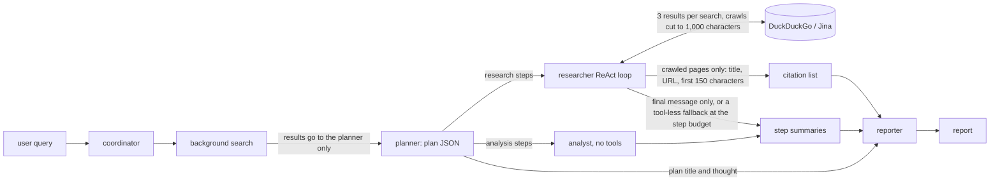
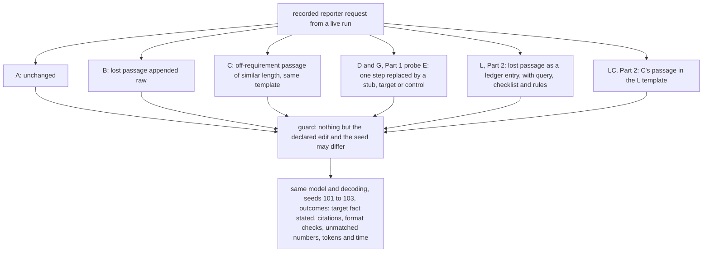

# Evidence loss at role handoffs in a DeerFlow deep-research loop

This repository holds the code, raw records and written answers for a two-part research assessment. The final report, "DeerFlow Study: Checkable Evidence Handoffs" (20 pages, SHA-256 `bc1398d477fbc5f3ebe53ef8c34e7a2ad763c3b321c83b22906d2d6c1c603df5`), is supplied separately and is the canonical presentation of the proposal.

**The assessment question.**
- **The system.** A multi-role deep-research agent: a Planner, one or more Researchers and a Reporter, all driven by one general-purpose LLM.
- **The metric.** A benchmark judge scores each report on Format, Factuality and Completeness.
- **The question.** How should those scores be improved? End-to-end agentic RL against the judge is the foil.

**The two parts.**
- **Part 1** analyses what end-to-end RL would face in this loop. It tests one premise on the real system: is requirement-relevant evidence lost at the researcher → reporter handoff, and does restoring it change the report?
- **Part 2** proposes what to do before, or instead of, end-to-end RL: a handoff that code can check, then targeted training only where that handoff still fails. It also runs one small, pre-registered pilot of the proposal's most uncertain premise.

The written answers are [`submission/part1.md`](submission/part1.md) and [`submission/part2.md`](submission/part2.md); everything else supports them.

| Implemented and run | Proposed only, not implemented |
|---|---|
| Runtime instrumentation of an unmodified, pinned DeerFlow 1.x graph, with strict record and replay of every model and tool call | The evidence ledger, source registry, quarantine of unsourced text and fallback repair (Part 2 §3) |
| 16 live attempts (10 completed) with a local 4B model and keyless web tools | The claim gate, including its claim detector and semantic verifier (Part 2 §3) |
| 86 reporter-only replays in Part 1 and 12 in Part 2. Each is a recorded reporter request changed only by a declared, guarded edit and the seed | Any training, including the SFT and preference-optimisation adapters (Part 2 §4) |
| Planted-defect probes of two local judges; blinded model-based audits by language-model sub-agents | The stop/continue policy (Part 2 §5); the fixed-retrieval handoff test, the whole-system comparisons on a frozen corpus, the human audit and the single held-out benchmark run (Part 2 §7) |

**What was not done.**
- No model was trained, and no reinforcement learning was run.
- The benchmark judge was never available, so no held-out score, and no held-out improvement, exists.
- No human annotator was used. Every label came from code or a language model.

**What this release contains.** The final report, and the detailed notes under `docs/` (protocols, results and analysis notes, corrections and reference checks), are not part of this release. They are in the full study archive, and any reference to a `docs/` path names a file there. [`RECORDS.sha256`](RECORDS.sha256) at the root lists the SHA-256 of the 426 record files under `runs/`, `analysis/` and `part2_pilot/outputs/`, unchanged from the full study archive, and [`INVENTORY.sha256`](INVENTORY.sha256) lists every file in the release.

## Contents

1. [The system under test](#1-the-system-under-test)
2. [What was run](#2-what-was-run)
3. [Findings](#3-findings)
4. [Repository map](#4-repository-map)
5. [Quick start: the offline path](#5-quick-start-the-offline-path)
6. [Recomputing derived results from the records](#6-recomputing-derived-results-from-the-records)
7. [Repeating the model runs](#7-repeating-the-model-runs)
8. [Limitations](#8-limitations)
9. [Records, provenance and third-party material](#9-records-provenance-and-third-party-material)

## 1. The system under test

DeerFlow's `main-1.x` branch, at commit `2ab28765803d4d9582aaa8f2f3355137d154e273`, implements the loop as a LangGraph graph.
- **The graph itself was not modified.** Instrumentation was injected at runtime ([`boundary_probe/deerflow_env.py`](boundary_probe/deerflow_env.py)).
- **What actually runs differs from the assessment's simplified diagram**, in ways that matter for credit assignment. The map below shows the pinned configuration as it ran. It allows one planning iteration, so the brief's "enough information?" loop back to the Planner never occurred.
- **Each statement below was checked in the pinned source.** Line references are rows K1–K13 of [`submission/evidence-index.md`](submission/evidence-index.md).



**What each role receives**, from the pinned source:

| Role | Receives | Hands on |
|---|---|---|
| Planner | the user's query and the background-search results, which no other role reads (K13) | the plan's title, "thought" and steps, and an "enough context" flag that would send the run straight to the reporter; it was false in all 10 runs (K1, E1) |
| Researcher | the plan title, not the query; earlier steps' summaries; its own step's title and description (`src/graph/nodes.py:1122–1125`); its search results, and crawled pages, each page cut to 1,000 characters (K3) | its final message as the step summary or, at the step budget, the reply of a re-call without tools (K5) |
| Analyst | the same task message as a researcher (plan title, earlier summaries, its own step), but no tools, so no search results or pages | its step summary |
| Reporter | the plan's title and "thought", each step's summary and the citation list (K2) | the report, with citations written by the model |

- **The reporter's view is narrow** (K2). It never receives the user's query verbatim, the step list or the full tool outputs, although in all 10 runs the plan's title and thought restated the query and its comparison axes. It receives only:
  - the plan's title and "thought";
  - each step's final summary;
  - a citation list giving each source's title, URL, domain and the first 150 characters of its description. Only crawled pages become citations, because DeerFlow cannot parse DuckDuckGo's plain-text results: all 27 citations in the 10 runs were crawled pages.
- **Most crawled text never reaches any model** (K3). Crawled pages are cut to their first 1,000 characters, so the model saw 4.8% of the crawled text: 19,930 of 419,236 characters over 28 crawls (E9).
- **A researcher that exhausts its step budget is called again with no tools** (K5).
  - This fallback fired in 4 runs.
  - In 3 of them the model wrote a tool call as plain text, and DeerFlow passed that string to the reporter as the step's entire summary (E8).
- **There is no post-research stop/continue decision** (K1). With `max_plan_iterations=1`, DeerFlow's default, the graph goes to the reporter once the plan's steps are done, so no run had a second research round. If more iterations were allowed, the Planner, called again after research, would make that decision, not the Reporter.
- **One model drives every role** (K7).

**DeerFlow 2.x is a different system.** Tag `v2.1.0` (`345f08be00c8a9495079b732a39b46aa9af1584e`) was audited read-only and never run.
- **What it is.**
  - It has one lead agent that can delegate to subagents through a `task` tool.
  - A subagent hands back only its last message.
  - There are no Planner, Researcher or Reporter nodes.
- **What Part 2 §11 proposes** for where the design would attach, without building it:
  - the source registry and verifier as tool-call middleware, at the point where 2.x already stamps tool receipts;
  - subagents that return ledger entries instead of free text;
  - the claim gate as an end-of-turn guard;
  - the coverage table as input to 2.x's opt-in goal evaluator.
- **Every observation in this repository comes from 1.x.**

## 2. What was run

| | Part 1: pre-registered diagnostic | Part 2: pre-registered pilot |
|---|---|---|
| Question | Is requirement-relevant evidence lost at the researcher → reporter handoff, and does restoring it change the report? | Given the same lost passage in the proposed ledger form, does the reporter state it? The ledger form is requirement-tagged, source-labelled and quote-verified, and comes with the query, a requirement checklist and rules for use. |
| Inputs | 8 development queries, each with a requirement checklist ([`experiments/dev_queries.yaml`](experiments/dev_queries.yaml)) | Recorded reporter requests from two Part 1 cases, c03 and c05 |
| Model calls | 16 live attempts (10 completed), 86 reporter replays, proxy-judge calls on reports and planted-defect probes | 12 reporter replays, the pre-registered maximum, in 36.1 minutes against a 45-minute limit |
| Labels | Deterministic detectors; a blinded model-based audit by two language-model sub-agents | A deterministic detector; a blinded model-based audit by two language-model sub-agents |
| Protocol | `docs/part1_protocol.md`, in the full study archive: amendments A1–A18 in its §11, and the integrity review's erratum A19 | `docs/part2_protocol.md`, in the full study archive: §1–9 and A0 fixed before the first model call, A1–A2 added during the run, A3 after it, A4–A6 later errata |
| Results | `docs/part1_results.md`, in the full study archive; the records and derived tables are in this release | `docs/part2_results.md`, in the full study archive; the generations, scores and labels are in [`part2_pilot/outputs/`](part2_pilot/outputs/) |

**Setup for every model call.**
- **Agent model:** `qwen3:4b-instruct-2507-q4_K_M`, served by Ollama 0.14.2 under the derived tag `dfprobe-qwen3-4b-ctx40k`.
  - Digest `cabd5246e16c`.
  - Settings `num_ctx 40960` and `num_predict 8192`.
- **Proxy judge:** `gpt-oss:20b`.
- **Tools:** DuckDuckGo search and the Jina reader, both keyless.
- **Hardware:** one Apple M4 Pro laptop, serving one request at a time. No money was spent.

**How a replay intervention works.**
- **One edit.** A replay re-sends a reporter request recorded during a live run, with one declared edit ([`boundary_probe/replay_reporter.py`](boundary_probe/replay_reporter.py), [`part2_pilot/pilot.py`](part2_pilot/pilot.py)).
- **A guard.** Before sending, it refuses any request that differs from the recording in anything other than the declared edit and the seed.
- **What this isolates.** Everything upstream of the reporter is held fixed, so the replay measures the edit's effect on the reporter.



## 3. Findings

**How to read these findings.**
- **Scope.** They come from a 4B quantised model with keyless tools, on 8 queries. They are case studies of mechanisms in one pinned system, not population estimates.
- **What transfers.** The rates may not transfer to a stronger model. The structure does: who sees what, where evidence is cut, and which fallbacks exist.
- **Evidence IDs.** E… and K… resolve in [`submission/evidence-index.md`](submission/evidence-index.md).

### Part 1

- **Requirement-relevant text is lost at the handoff** (pre-registered H1a, supported; E11, E8).
  - In 6 of 9 eligible runs, requirement-relevant text that a researcher received never reached the reporter.
  - In 3 of those runs the step summary dropped the passage. In the other 3, the recursion fallback replaced the whole summary with a tool-call string.
  - Five of the six passages were search snippets and one was text from a crawled page (post hoc). Whether that text could meet a requirement's acceptance criterion was not assessed, so 6 of 9 is not a count of lost admissible evidence.
  - Five of the six became replay cases c01–c05. The sixth had no admissible control passage.
- **Restoring the passage rarely changed the report** (pre-registered H1b, failed by its own rule; E12, E13).
  - Appended back raw (arm B), the lost fact was stated correctly in 2 of 15 samples. Without it (arms A and C), it was stated correctly in 0 of 30.
  - A blinded audit of the seed-101 samples found it stated correctly in 0 of 5 B reports.
  - The pre-fixed keyword detector called one case, c05, an effect. A later, unblinded model-based reading (post hoc) showed that this was a false positive. With that correction, all five cases met the pre-registered rule for "reporter insensitivity".
  - No arm wrote the fact into a summary's prose, so there was no positive control.
- **The reporter relays what it is given** (post hoc; E10).
  - Numbers written into step summaries reached the report about as often when their step was flagged as never having searched (45 of 51, 88%) as when retrieved text contained them (23 of 26, 88%).
  - These are the 2026-10-01 recheck's figures, after dates, error codes, duplicates and small unitless integers were removed. No contrast between the two rates is supported. The first published contrast, 79% against 89%, counted those items and is withdrawn.
- **Unsupported content mostly comes from upstream** (exploratory probe E; E14).
  - Replacing the step that introduced unmatched numbers with a stub removed those numbers from the report in all 3 numeric cases, for example 16 → 0.
  - With an analyst step's unsupported ratings table removed, the reporter rebuilt a table in 2 of 3 samples.
- **Provenance** (E6). 93 of 132 report numbers appear in no retrieved text, and 26 of 80 cited URLs were never retrieved. This is a provenance metric, not an error rate.
- **The local judges we could test did not catch these failures** (K4, E16, E20).
  - DeerFlow's in-repo judge never sees the evidence.
  - Our proxy judge selected only 1 of 6 planted factuality probes for checking, and that case was uninformative.
  - Its completeness score fell when unmatched numbers were removed, in 3 of 3 cases, one sample each.
- **Replays reproduced the original reports byte for byte in 5 of 5 cases** during the Part 1 session (E12). A later session found an exception (Part 2, below).
- **Cost of one live trajectory, on average** (E3): 435 s, 12.7 model calls, 61,805 prompt and 8,316 generated tokens, and 8.1 tool calls.

The analysis of what end-to-end RL would face in this loop is in [`submission/part1.md`](submission/part1.md).

### Part 2 pilot

The pilot asked whether presenting a lost passage in the proposed ledger form makes the 4B reporter state it. It used two cases:
- **c03**, where the fact was lost by summary omission;
- **c05**, where it was lost to the recursion fallback.

Each cell counts the distinct reports that the blinded audit labelled as stating the restored fact correctly.

| Case | A, unchanged | B, raw append | C, control | **L, ledger form** | LC, control in L form | Pre-registered verdict |
|---|---|---|---|---|---|---|
| c03 | 0/4 | 0/3 | 0/3 | **0/3** | — | ledger insensitivity |
| c05 | 0/3 | 1/3 | 0/3 | **2/3** | 0/1 | ledger uptake, by the letter of the rule |

- **Where the reports come from.**
  - A, B and C are Part 1's samples at seeds 101–103.
  - c03's A also counts the pilot's reproduction attempt, which diverged from Part 1's sample.
  - The pilot's own B samples were byte-identical to Part 1's, so each counts once.
- **The verdict is mixed.**
  - The pilot did not show that presentation alone fixes nonuse, and it sets no training priority.
  - The c05 difference is one sample, with three seeds per arm. That is weak, local evidence.
  - One of the two positive L reports states only the first half of the core statement, and one auditor labelled it. Without it, the pilot would be negative. The pre-registered verdict, mixed, stands.
  - Suppose each sample is an independent Bernoulli draw with no true effect. Then this pattern has probability 0.09–0.25 under the protocol's three-sample B rule, and 0.10–0.38 under amendment A1's two-sample rule, for per-sample probabilities from 0.2 to 0.5. That is an illustration, not a p-value.
- **It did not test a functioning, checked ledger.** Both target entries quoted search snippets, which the proposed rules would not admit as evidence, and no gate ran.
- **"Target-fact uptake" is narrow.**
  - The label means only that the report's body text states at least one core statement of the restored passage, consistently with it.
  - Other claims, even unsupported ones, do not change the label.
  - Both positive L reports attach an unsupported or questionable claim to the fact:
    - "zero accuracy loss", which came from another source through the planner's thought;
    - an unmarked derived "5.3×".
- **The ledger form had side effects.**
  - All 6 L reports adopted `[S#]` citation markers, which none of the other 20 distinct reports used. 5 of the 6 misused the labels.
  - All 3 c03 L reports failed 6 of Part 1's 8 format checks. Part 1 had seen that failure in 1 of 9 seeded c03 samples.
- **Label quality.**
  - Two language-model sub-agents labelled 30 packets holding 26 distinct reports.
  - They agreed on all 6 packets they both saw, but all 6 were negatives. Each positive L report was labelled by one auditor only.
  - The pre-registered deterministic detector agreed with the audit on all 26 reports.
- **One replay did not reproduce.**
  - The pilot's first request resent Part 1's c03 input with seed 101. Its output matched Part 1's for 3,219 characters and then diverged.
  - The four other resent requests reproduced Part 1's outputs byte for byte.
  - The cause is unknown. Prompt-cache involvement is an unverified hypothesis.

Everything else in Part 2 is a proposal, specified in [`submission/part2.md`](submission/part2.md) and not implemented:
- the ledger;
- the claim gate;
- the training objectives and data recipe;
- the stop/continue estimator;
- the fixed-retrieval handoff test with its equivalence criterion, the whole-system comparisons on a frozen corpus, and the human audit of any coverage gain;
- the single held-out benchmark run.

## 4. Repository map

```text
submission/        the assessed answers: part1.md, part2.md, and evidence-index.md (the E and K evidence IDs)
boundary_probe/    Part 1 code: runtime hooks, strict record and replay, reporter replays, evidence tracing,
                   the proxy evaluator, judge probes, the blinded audit, derived tables and the rechecks
part2_pilot/       the Part 2 pilot: pilot.py (variants, guard, caps), score.py (measures, audit export and
                   unblinding), test_pilot.py, and outputs/ (raw generations, run log, scores, audit labels)
tests/             Part 1 tests; four need the pinned DeerFlow checkout and skip without it
experiments/       pinned run configuration, development queries, Ollama Modelfiles, serving and judge checks
runs/              raw records of the 16 live attempts and the 86 Part 1 replays
analysis/          derived tables, case files, proxy evaluations, judge probes, the Part 1 audit and the rechecks
RECORDS.sha256     SHA-256 of the 426 record files under runs/, analysis/ and part2_pilot/outputs/
INVENTORY.sha256   SHA-256 of every file in this release
```

| To check… | Read |
|---|---|
| the argument about end-to-end RL | [`submission/part1.md`](submission/part1.md); its long form, `docs/part1_analysis.md`, is in the full study archive |
| where each Part 1 number comes from | [`submission/evidence-index.md`](submission/evidence-index.md) |
| what Part 1 pre-registered, and every later amendment | `docs/part1_protocol.md`, in the full study archive |
| what Part 1 observed | [`analysis/tables.md`](analysis/tables.md), [`analysis/cases/review_log.md`](analysis/cases/review_log.md), [`analysis/cases/replay_notes.md`](analysis/cases/replay_notes.md); the results note, `docs/part1_results.md`, is in the full study archive |
| the recomputations of published figures | [`analysis/rechecks.md`](analysis/rechecks.md) |
| the Part 2 proposal | [`submission/part2.md`](submission/part2.md) |
| the pilot's pre-registration and results | [`submission/part2.md`](submission/part2.md) §8; `docs/part2_protocol.md` and `docs/part2_results.md` are in the full study archive |
| the pilot's raw generations and audit labels | [`part2_pilot/outputs/`](part2_pilot/outputs/) |
| how each reference was checked | `docs/references.md` and `docs/part2_references.md`, in the full study archive |

## 5. Quick start: the offline path

This path needs Python 3.13 and nothing else:
- no DeerFlow checkout;
- no Ollama or model;
- no network after the packages are installed.

It also does not need the separate evidence archives, because their records are included here under `runs/`, `analysis/` and `part2_pilot/outputs/`.

```bash
python3.13 -m venv .venv
source .venv/bin/activate
pip install -r requirements-offline.txt
python -m pytest
shasum -a 256 -c RECORDS.sha256       # on Linux: sha256sum -c RECORDS.sha256
shasum -a 256 -c INVENTORY.sha256
```

**Expected result:** `62 passed, 4 skipped`, in a few seconds, and `OK` on every line of both checksum lists.
- The four skipped tests replay a recorded run through DeerFlow's own graph code, so they need the pinned checkout.
- Run with the checkout's environment, as in [§7](#7-repeating-the-model-runs), all 66 pass.
- `requirements-offline.txt` pins all 37 packages at the versions the tests ran with, under Python 3.13.2. Other Python versions were not tested.
- The tests were also run in a fresh environment installed from PyPI with exactly those pins.

**What the offline tests check:**
- **Strict tool replay.** An unrecorded call is an error, and repeated calls return their recordings in order.
- **The replay guard.** Every replay variant differs from its recorded request only by the declared edit and the seed.
- **Passage provenance.** Every inserted passage is verbatim in the recorded tool output it cites.
- **Recorded handoffs.** In every completed run, the recorded reporter input contains each researcher handoff verbatim.
- **Provenance metrics.** The number and URL matching behind them.
- **The proxy evaluator.** Its quote matching and judge-output parsing.
- **Probe and audit tooling.** The planted-defect editors, and the audit's packet split.
- **The Part 2 detector window,** on known Part 1 samples.
- **The integrity review's recomputations,** in `analysis/rechecks.md`.

## 6. Recomputing derived results from the records

These commands read only files in this repository and need only the offline environment. Each rewrites its outputs in place.

```bash
python -m boundary_probe.tables            # analysis/tables.md and analysis/tables/*.csv
python -m boundary_probe.replay_analysis   # analysis/replays.json and analysis/replays.md
python -m boundary_probe.rechecks          # analysis/rechecks.json and analysis/rechecks.md
python -m part2_pilot.score table          # part2_pilot/outputs/scores.json
python -m part2_pilot.score unblind part2_pilot/outputs/audit/labels_auditor1.json part2_pilot/outputs/audit/labels_auditor2.json
python -m part2_pilot.score summary > part2_pilot/outputs/summary.md
python -m part2_pilot.pilot --dry-run      # rebuilds and guard-checks the 11 edited pilot requests; sends nothing
shasum -a 256 -c RECORDS.sha256            # on Linux: sha256sum -c RECORDS.sha256
```

- **The checksum list covers every file the other commands rewrite.** [`RECORDS.sha256`](RECORDS.sha256) lists the SHA-256 of all 426 files under `runs/`, `analysis/` and `part2_pilot/outputs/`. If every line reports `OK`, the recomputation was byte-identical. In the full study archive this list is `docs/records.sha256`; its content is unchanged.
- **What the derived files hold:**
  - costs, the evidence funnel, number origins, relay, crawl truncation and baseline proxy scores (`tables`);
  - Part 1's replay verdicts under the pre-registered rules (`replay_analysis`);
  - the integrity review's recomputations of published figures (`rechecks`);
  - the pilot's deterministic measures (`score table`);
  - its audit labels joined to the unblinding key (`score unblind`);
  - its per-sample table (`score summary`).

**The raw record formats:**
- **`runs/<run>/raw/` holds each live attempt:**
  - `manifest.json`: commit, configuration, model digest, prompt and code hashes, and timings;
  - `llm_calls.jsonl`: the exact request and response of every model call;
  - `tool_calls.jsonl`: the replay cassette, with every tool output exactly as the model received it;
  - `crawl_fulltext.jsonl`: crawled pages before DeerFlow's 1,000-character cut;
  - `state_snapshots.jsonl`, `final_state.json`, `report.md` and `deerflow.log`.
- **`runs/<run>/replays/<case>/<arm>-s<seed>.json`** holds each Part 1 replay.
- **`part2_pilot/outputs/<case>/<arm>-s<seed>.json`** holds each pilot generation: the exact request sent, the declared appended text, the response, usage and timings.

## 7. Repeating the model runs

None of this is needed to review the repository.
- **Cost.** These steps are slow on a laptop: about 7 minutes per live run and 1.5–3 minutes per reporter replay.
- **Reproducibility.** Their outputs are not byte-reproducible. Live web results drift, and Part 2 found that even a replay can diverge across sessions.

**The pinned DeerFlow checkout and its environment.** This step needs network access.

```bash
git clone --branch main-1.x --single-branch https://github.com/bytedance/deer-flow.git vendor/deer-flow-1x
git -C vendor/deer-flow-1x checkout 2ab28765803d4d9582aaa8f2f3355137d154e273
pip install uv==0.12.21                    # inside the section 5 environment; this uv version was used
(cd vendor/deer-flow-1x && uv sync --frozen --python 3.13 --extra test)
PY=vendor/deer-flow-1x/.venv/bin/python
$PY -m pytest                              # 66 passed
```

**DeerFlow 2.x, only to check the line references in Part 2 §11:**

```bash
git clone --depth 1 --branch v2.1.0 https://github.com/bytedance/deer-flow.git vendor/deer-flow-2x   # 345f08be00c8…
```

**The models, served by Ollama.** Ollama 0.14.2 was used.

```bash
ollama pull qwen3:4b-instruct-2507-q4_K_M
ollama create dfprobe-qwen3-4b-ctx40k -f experiments/ollama/Modelfile.dfprobe-qwen3-4b-ctx40k
ollama pull gpt-oss:20b
ollama create dfprobe-gptoss-20b-ctx32k -f experiments/ollama/Modelfile.dfprobe-gptoss-20b-ctx32k
```

- **The derived tags matter.** They pin the context and output limits. Without them, Ollama's OpenAI-compatible endpoint would silently cut prompts to their last 4,096 tokens and ignore the requested output limit (Part 1 protocol, amendments A2 and A12, in the full study archive).
- **Ollama tags can be republished.** Each run's `manifest.json` records the model digest it used.

| Command | Needs | Writes |
|---|---|---|
| `$PY -m boundary_probe.run_query q01 --tag r99` | DeerFlow checkout and environment; Ollama with the agent model; network for DuckDuckGo and Jina | a new `runs/q01-r99-<local time>/`; also DeerFlow's `conf.yaml` inside the checkout |
| `python -m boundary_probe.replay_reporter analysis/cases/c01.yaml --reproduce` | Ollama with the agent model | Part 1 arms A, B and C, plus a resend of the original request, under `runs/<run>/replays/c01/` |
| `python -m boundary_probe.replay_reporter analysis/cases/e01.yaml` | Ollama with the agent model | probe E arms A, D and G |
| `python -m boundary_probe.evaluate runs/<run> --judge-model gpt-oss:20b` | Ollama with `gpt-oss:20b` | the proxy evaluation, in `analysis/evals/<run>/baseline.json` |
| `$PY -m boundary_probe.probes analysis/probes/spec.yaml --judge-model gpt-oss:20b --in-repo-judge-model dfprobe-gptoss-20b-ctx32k` | DeerFlow checkout and environment; Ollama with both judge tags | planted-defect probes, under `analysis/probes/` |
| `python -m part2_pilot.pilot` | Ollama with the agent model, and the `ollama` command for its concurrency check | pilot generations under `part2_pilot/outputs/`; capped at 12, with no request started more than 41 minutes after the first |

- **Commands shown with `python` import nothing from DeerFlow.** They can run in either environment.
- **No API key is used anywhere.** The only `api_key` value is the placeholder `ollama`, which the OpenAI-compatible client requires.

**The commands protect shipped outputs, with two exceptions.**
- `replay_reporter`, `probes` and the pilot skip any generation whose output file already exists. As shipped, they therefore send nothing for completed cases. To repeat a case, move its outputs aside.
- `replay_reporter` still rewrites the case's `replay_manifest.json`.
- `evaluate` reuses a stored result only when the report and judge settings match. Otherwise it overwrites the stored result.

Every command run in Part 1 is listed, in order, in [`analysis/commands_executed.md`](analysis/commands_executed.md).

## 8. Limitations

- **A small, weak substrate.**
  - One 4B quantised model, keyless tools, 8 development queries and 10 completed runs.
  - Behaviours such as skipped searches, invented URLs and tool calls written as text may be much rarer with the "competent generalist" model the assessment assumes.
- **No benchmark judge.** Every judged score comes from local proxies. Their failure modes were measured, not assumed away.
- **No human labels.** The audits were blinded model-based labels from language-model sub-agents, and the unblinded readings were model-based too. In Part 2, blinding was partial, because ledger-form reports carry distinctive citation markers.
- **Some steps were never exercised.** No run had a stop/continue decision to make, and nothing was trained.
- **Runs are not reproducible.** Live runs depend on live web results, and exact replay is not guaranteed across serving sessions.
- **Why the Part 2 pilot is not evidence of a general improvement:**
  - it has two cases, both already inspected in Part 1, and three seeds per arm;
  - one ledger entry was appended at the end of a step's free-text summary, in c03 after its References list. That is neither the full design nor a bound on salience;
  - both entries quoted search snippets, so no functioning, checked ledger was tested;
  - no arm wrote the fact into a summary's prose, so there was no positive control;
  - the intervention bundles the query, the checklist, the entry format and the rules;
  - the reporter was given the evaluation checklist itself, which acts as an oracle requirement index;
  - the entries were oracle passages from Part 1's case files, not researcher-written entries;
  - no judge was run, so it says nothing about the judged axes.

  It tested whether presentation alone could fix nonuse, and it did not show that.

## 9. Records, provenance and third-party material

**The assessment evidence archives are distributed separately.** They are not part of this repository:

| Archive | SHA-256 |
|---|---|
| Part 1: `t1-part1-review.tar.gz` | `b8faa7a60aa9d849fb1630c44dfd2bbaf685755244549ea360aafee240e9032e` |
| Part 2: `t1-part2-review.tar.gz` | `65e7fa095fa3d88cbc30ca87170340c692d58ead57ba318d389779d3d6d4375b` |

**How this release relates to them.**
- **459 of this release's 475 files are byte-identical to their copies in the archives.** They include the raw records, generations, scores and audit labels, and all the archives' code except `tests/conftest.py`.
- **Six files differ from their archive copies:**
  - this README;
  - `submission/part1.md`, `submission/part2.md` and `submission/evidence-index.md`, which carry dated corrections from the integrity review of 2026-10-01, and edits of 2026-10-02 that align them with the final report and with this release;
  - `analysis/cases/replay_notes.md`, which gains a dated correction note;
  - `tests/conftest.py`, which gains a guard that skips the DeerFlow-dependent tests when the pinned checkout is absent.
- **Ten files are new:**
  - the integrity review's recomputation module, its test and its outputs: `boundary_probe/rechecks.py`, `tests/test_rechecks.py`, `analysis/rechecks.json` and `analysis/rechecks.md`;
  - the packaging files `.gitignore`, `pytest.ini`, `requirements-offline.txt` and `THIRD_PARTY_NOTICES.md`;
  - the checksum lists `RECORDS.sha256` and `INVENTORY.sha256`.
- **Not included:**
  - the archives' own packaging files: inventories, manifests, checksum lists, and reference and test logs;
  - the assessment brief, the DeerFlow checkouts, virtual environments and model weights;
  - the final report and the `docs/` notes, which are in the full study archive.

**The pre-registrations cannot be checked from this release alone.**
- `part2_pilot/outputs/prerun_state.txt` records the Part 2 protocol's SHA-256 at 10:44:11 UTC; the first model call came 5 seconds later. The protocol is in the full study archive, where `head -c 19899 docs/part2_protocol.md | shasum -a 256` reproduces `9da4d9f158874d4c06b30cb325d86fd6ed088d87006111d6599c89dd3bb44618`.
- The SHA-256 at registration of the Part 1 checklists, `experiments/dev_queries.yaml`, is recorded only in the Part 1 protocol, also in the full study archive.

**Raw records are kept verbatim, with two consequences.**
- **Absolute paths.** Eight files contain absolute paths from the machine the study ran on:
  - the manifests of the six failed attempts;
  - the DeerFlow log of run `q03-r01`, which was flagged as outage-affected and excluded from the H1 case selection only;
  - the header of `analysis/commands_executed.md`.
- **Third-party text.** The records also contain:
  - text from public web pages, including contact e-mail addresses printed on those pages;
  - prompt text from DeerFlow's MIT-licensed templates.

  See [`THIRD_PARTY_NOTICES.md`](THIRD_PARTY_NOTICES.md).

**Licence.** No licence has yet been chosen for this repository's own code and documents.
