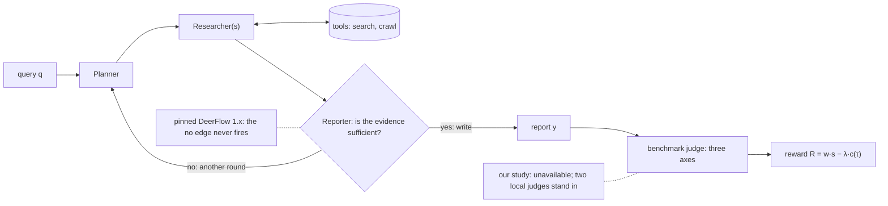
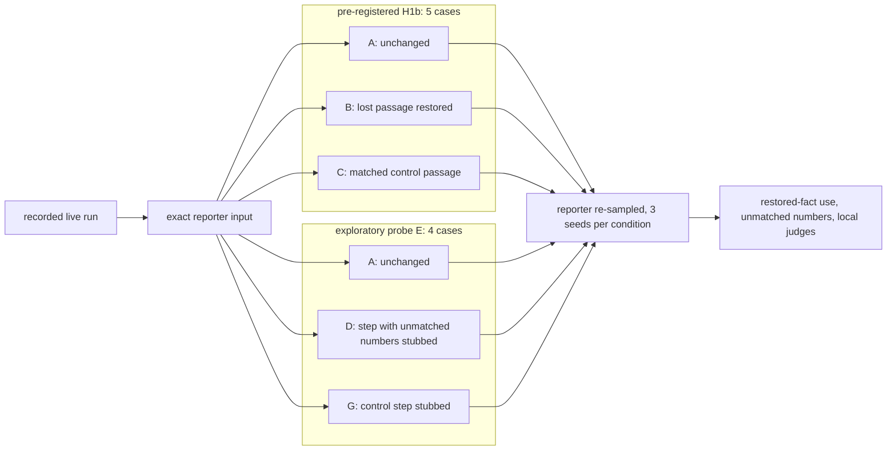

# Part 1 — What end-to-end agentic RL would face in this deep-research loop

The study behind this document is frozen. Evidence IDs (E = archived record, K = pinned source line) resolve in `submission/evidence-index.md`. The final report, supplied separately, is the canonical presentation; this is the longer Part 1 answer. Paths under `docs/` name detailed notes in the full study archive, which this repository release omits; there, `docs/corrections.md` lists the statements corrected by the integrity review of 2026-10-01 and the reconciliation of 2026-10-02.

**Labels.**
- [brief]: the take-home PDF.
- [code]: DeerFlow `main-1.x` @ `2ab2876`.
- [observed]: measured in our runs.
- [inference]: derived or argued from stated assumptions.
- [illustrative]: constructed, or assumed.

## 0. Summary

End-to-end (E2E) RL on this loop has a well-defined objective and an unbiased gradient [inference]. The obstacles are how little one report-level number tells the optimiser about *which* role to change, and how noisy and gameable that number is. Three pipeline-specific problems dominate.

1. **Credit along an evidence path is multiplicative.** On the researcher-summary path, a retrieved fact reaches the report only if the researcher writes it into its summary *and* the reporter, given it there, states it. Each behaviour's expected learning signal therefore scales with the other's success rate [inference].
   - A lost passage restored at the reporter's input was stated correctly in 2 of 15 replays [observed, E13].
   - Claims also reach the reporter by other routes. In 3 of 10 runs, the planner's "thought" passed one on without its source [observed, E24].
2. **The reward is a weak factuality measure.** The brief's benchmark judge was unavailable, so we tested two local judges.
   - DeerFlow's in-repo judge never sees the evidence [code, K4].
   - Our proxy evaluator selected only 1 of 6 factuality-probe sentences for checking, and that case was uninformative [observed, E16].
3. **The Reporter's stop/continue decision** [brief] is credited only through the final score minus cost. A single trajectory's reward does not show whether another round had positive expected value. DeerFlow's default configuration, which we kept (`max_plan_iterations = 1`), never reaches a post-research decision, so we could not test it; when it is enabled, DeerFlow 1.x gives the decision to the Planner, not to the Reporter [code, K1].

**One negative result: H1b** (§6). H1b predicted that restoring a lost, relevant passage at the reporter's input would make the reporter state it.
- *Pre-registered result* [observed, E12].
  - The keyword detector, fixed before any replay, found 4 of the 5 selected cases insensitive and 1 an apparent effect.
  - By the pre-registered rule, insensitivity in a majority of cases fails H1b, so H1b failed.
- *Later correction* [observed, E12].
  - A later, unblinded model-based reading showed the apparent effect to be a detector false positive, so substantively all 5 cases are insensitive.
  - This 5/5 is a post-hoc correction, not the pre-registered detector's result.
- *Scope.* The result concerns five selected cases, a raw passage appended at the end of the step's observation, and one 4B reporter. It does not show that the reporter cannot use evidence: no condition wrote the fact into the summary's own prose (§6).

## 1. The loop, the reward, and what we could test

How the loop works [brief]:
- The Planner writes research steps.
- Researchers run those steps with tools and return evidence summaries.
- The Reporter decides whether the evidence suffices. If it does, it writes the report; if not, control returns to the Planner.
- One LLM plays every role.
- A benchmark judge scores each report once per axis: Format, Factuality ("claims … supported by retrieved/citable evidence") and Completeness.

**Symbols.**
- **Query and history.** $q$ is the query. $x_{<t}=(q,a_0,o_0,\dots,a_{t-1},o_{t-1})$ is the history before model call $t$: every earlier action and tool output.
- **Model calls.** The graph builds call $t$'s context $h_t$ deterministically from $x_{<t}$, and each role sees a different view. From $h_t$, the shared model $\pi_\theta$ (parameters $\theta$) generates tokens $a_t=(a_t^1,\dots,a_t^{L_t})$, including the Reporter's stop/continue decision.
- **Tool outputs.** If $a_t$ calls a tool, the environment returns $o_t\sim P_{\text{env}}(\cdot\mid x_{<t},a_t)$; otherwise $o_t$ is empty.
  - The output may depend on the whole history, on rate limits and on the state of the web.
  - Searches the graph makes on its own, such as DeerFlow's background search, are environment outputs with no model action.
- **Trajectory.** $\tau$ is the whole sequence. It ends with the report $y$, if one is written.
- **Judge scores.** $s(y,q;\xi)\in[0,1]^3$ are the benchmark judge's three scores, where $\xi$ is the judge's randomness and $\bar s$ the mean over $\xi$. $w\ge0$ weights the axes.
- **Cost.** $u(\tau)$ counts resources: prompt tokens, generated tokens, tool calls and wall-clock seconds.
  - $c(\tau)=\kappa^\top u(\tau)$ prices them in one currency (e.g. dollars), with unit prices $\kappa\ge0$.
  - $\lambda\ge0$ converts currency into reward units.

**Reward.** There are three cases.
- **A report is produced and scored:** $R=w^\top s(y,q;\xi)-\lambda c(\tau)$.
- **The policy produces no report.** Then $R=r_{\text{fail}}-\lambda c(\tau)$. Examples:
  - a plan that cannot be parsed in round one, or a coordinator that does not hand off, both of which end DeerFlow's run [code, K11, K12];
  - an exceeded time or call budget.

  Choose $r_{\text{fail}}<-\lambda\,c_{\text{saved}}$, where $c_{\text{saved}}$ is the most cost a failure can save over a report. Since $w^\top s\ge0$, any report then beats any failure, so failing early cannot become a cheap way to score [inference].
- **The environment or the judge fails** (an outage, a judge timeout). No reward is assigned; the trajectory is logged and masked from the update [inference].
  - Masking needs detectors for partial failures too (C5).
  - Masking is unbiased only if such failures do not depend on the policy. A policy that calls tools more often meets more outages.

The objective is $J(\theta)=\mathbb E[R]$, taken over queries, unmasked trajectories and judge noise.

**Our runs differ from the brief in four ways.**
1. **There is no decision after research** [code, K1].
   - `max_plan_iterations=1` is DeerFlow's default, and we kept it. After the first round of research the graph returns to the planner node, which then routes to the reporter without a model call, so no run had a second round [observed, E1].
   - The planner's `has_enough_context` flag belongs to the plan written *before* research. It was false in 10 of 10 runs, which only means that every run researched.
   - With `max_plan_iterations` of 2 or more, the post-research decision would exist, but the Planner would make it: a second planner call, over a conversation that by then holds the researchers' messages, sets `has_enough_context` again. The brief gives this decision to the Reporter.
   - This is a **limitation of our experiment, not evidence that the decision is unimportant**.
2. **The reporter sees a narrow view** [code, K2]:
   - the plan's title and "thought";
   - each step's final summary;
   - a citation list giving each source's title, URL, domain and first 150 characters of text.

   It never receives the user's query verbatim, the step list or the full tool outputs. It does receive the planner's restatement: in all 10 runs the plan title and thought restated the query and its comparison axes (75–93% of the query's content words; nine thoughts open "The user is asking …").
3. **One model plays every role** [code, K7].
4. **We had no benchmark judge.** We tested two local judges instead, and every judge score here comes from them:
   - our proxy evaluator: deterministic format checks, plus `gpt-oss:20b` calls for completeness and claim support;
   - DeerFlow's in-repo LLM judge, run on the same `gpt-oss:20b` weights.

## 2. The gradient, step by step [inference]

**Step 1: the probability of a trajectory.** Model calls alternate with tool outputs, and the graph's routing and views are deterministic functions of the history:
$$p_\theta(\tau\mid q)=\prod_t\pi_\theta(a_t\mid h_t)\,P_{\text{env}}(o_t\mid x_{<t},a_t).$$

**Step 2: differentiate.** Let $\bar R(\tau)=\mathbb E_\xi[R]$. The judge is frozen, so for each query $\nabla J=\sum_\tau\bar R(\tau)\,\nabla p_\theta(\tau\mid q)$.

**Step 3: the log-derivative trick.** Since $\nabla p=p\,\nabla\log p$, we get $\nabla J=\mathbb E_\tau[\bar R\,\nabla\log p_\theta(\tau\mid q)]$, which sampling can estimate.

**Step 4: only model tokens carry $\theta$.**
- The log turns the product into a sum.
- The environment factors do not depend on $\theta$, so their gradients vanish.
- Each call's log-probability splits into its tokens' log-probabilities:
$$\nabla J=\mathbb E\Big[\bar R(\tau)\sum_t\sum_k\nabla\log\pi_\theta(a_t^k\mid h_t,a_t^{<k})\Big].\qquad(1)$$

This is REINFORCE (Williams, 1992).

**Token-specific baselines.** A sampled estimate may subtract a separate baseline $b_{t,k}$ for each token:
$$\hat g=\sum_t\sum_k\big(R-b_{t,k}\big)\,\nabla\log\pi_\theta(a_t^k\mid h_t,a_t^{<k}).\qquad(2)$$
Here $R$ is a single judge draw; since $\mathbb E_\xi R=\bar R$, this changes nothing in expectation. The estimate $\hat g$ is unbiased whenever each $b_{t,k}$ is of one of two kinds:
- **(i)** it depends only on what was known before token $k$ was sampled ($q$, $h_t$, $a_t^{<k}$); or
- **(ii)** it is independent of that token given that information, such as other rollouts' rewards.

*Why.* Write $z$ for the token's context. For type (i), $b$ is fixed given $z$, so $\mathbb E_{a\sim\pi(\cdot\mid z)}[b\,\nabla\log\pi(a\mid z)]=b\,\nabla\sum_a\pi(a\mid z)=b\,\nabla1=0$. For type (ii), $b$ factors out of the expectation by independence, and the same sum is zero.

**Common choices.**
- **Per query.** RLOO sets $b_{t,k}=b_i$ for every token of rollout $i$. Here $b_i$ is the mean reward of the other $G-1$ rollouts of the same query, which is type (ii) (Kool et al., 2019; Ahmadian et al., 2024).
- **GRPO** subtracts a group mean that includes $R_i$. Since $R_i-\text{mean}=\tfrac{G-1}{G}(R_i-b_i)$, it points the same way as RLOO. Its standard-deviation scaling is not covered by this argument (Shao et al., 2024).
- **Per call.** A learned value sets $b_{t,k}=V(h_t)$ for all of call $t$'s tokens, which is type (i). A value computed from a *later* context would bias earlier calls' terms. For example, the reporter's input depends on the plan.

**Assumptions.** Unbiasedness also needs four things:
- the judge, the tools and the graph do not depend on $\theta$;
- tool outputs stay in the context but are masked out of the loss (Jin et al., 2025);
- samples are on-policy;
- the log-probabilities are those of the exact tokens under the exact contexts.

The last is fragile here. Serving was quantised, and DeerFlow re-appends the researcher's system prompt every turn [code, K10]. Contexts must therefore be rebuilt byte for byte from the recorded calls.

**How the scalar is spread.** With a per-query baseline, every generated token of rollout $i$ is multiplied by the same $R_i-b_i$.
- **Measured shares of generated tokens** [observed, E4]: reporter 41%, researcher 34%, analyst 17%, planner 7.5%, coordinator 0.7%.
- **Token shares are not update shares.** These shares count terms, not update weight.
  - Each term has size $|R_i-b_i|\cdot\lVert\nabla\log\pi\rVert$.
  - Near-certain tokens (JSON punctuation) contribute almost nothing.
  - A few high-entropy decisions — whether to search, whether to stop — can dominate.
- **Aggregation re-weights roles.** Summing or averaging per sequence silently changes how much each role counts, so the choice is a design decision.

**Unbiased is not efficient.**
- **The decomposition.** For the plan's tokens, take $b_{p,k}=V(h_p)$. Then $R-V(h_p)=A+\eta$, where:
  - $Q=\mathbb E[\bar R\mid h_p,a_p]$ and $V=\mathbb E[\bar R\mid h_p]$;
  - $A=Q-V$ is the plan's true advantage;
  - the noise $\eta$ has $\mathbb E[\eta\mid h_p,a_p]=0$.
- **No systematic miscredit, only variance.** Suppose a sound plan is followed by a researcher that drops the evidence. That sample pushes the plan down; samples where the researcher succeeds push it up. Averaged over what follows, the push equals the plan's true advantage.
- **Small true advantages.** $Q$ assumes the other roles' *current* behaviour. So a better researcher, paired with a reporter that ignores its evidence, has a genuinely small advantage (C1).

**How many rollouts it takes to tell two plans apart.** Let plans $a$ and $a'$ differ by $\Delta$ in expected reward. Give each $n$ independent rollouts with per-rollout standard deviation $\sigma$ (§4).
1. Each plan's mean-reward estimate has variance $\sigma^2/n$.
2. Their difference has variance $2\sigma^2/n$, so its standard error is $\sqrt{2\sigma^2/n}$.
3. Requiring $\Delta$ to be at least two standard errors gives $\Delta\ge2\sqrt{2\sigma^2/n}$, that is, $n\ge8\sigma^2/\Delta^2$.
4. At exactly that $n$, the observed difference clears two standard errors only about half the time. For 80% power at a two-sided 5% level, the requirement is $n=2(1.96+0.84)^2\sigma^2/\Delta^2\approx15.7\,\sigma^2/\Delta^2$.

Take $\sigma=0.15$ and $\Delta=0.05$, so $\sigma^2/\Delta^2=9$. That needs about 72 rollouts per plan under the two-standard-error rule, and about 141 for 80% power [illustrative].

**PPO's clip** (Schulman et al., 2017). Take a token with probability ratio $r$ (new over old) and estimated advantage $\hat A$.
- The objective $\min(r\hat A,\ \mathrm{clip}(r,1\pm\epsilon)\hat A)$ stops *rewarding* movement of $r$ beyond $1\pm\epsilon$ in the direction $\hat A$ favours.
- It does not bound the actual change. Shared parameters, other tokens' gradients and repeated epochs can push $r$ outside the range. A ratio that lies outside on the other side keeps its gradient.
- So $\epsilon$ limits the incentive, not the step.

## 3. What a report-level reward can and cannot identify [inference]

The judge sees only $(y,q)$. Two trajectories that produced, and were scored on, the same report therefore get the same score distribution, and their rewards differ only through cost:
$$y(\tau_1)=y(\tau_2)\Rightarrow\mathbb E_\xi[R(\tau_1)]-\mathbb E_\xi[R(\tau_2)]=-\lambda\big(c(\tau_1)-c(\tau_2)\big).$$
Cost says how much was spent, not which role failed.

Take the brief's query [illustrative], and a report that gives latency only as "long-context models are generally slower", with no figure and no source. Four trajectories end in exactly this report:

| | Mechanism | Trace signature | Right target |
|---|---|---|---|
| M1 | The plan has no latency step | no step covers latency | Planner |
| M2 | The summary drops a retrieved figure | figure in the tool output, not in the summary | Researcher / interface |
| M3 | The reporter ignores a figure it was given | figure in its input, not in the report | Reporter |
| M4 | The reporter stops despite a stated gap, *when another round had positive expected net value* | gap stated, no further round | Stop/continue |

**When M4 is an error.** Let $H$ be the history at the Reporter's decision. Let "continue" mean running one more round and then following the current policy. The stop is wrong only if the expected net value of that round is positive:
$$\mathrm{VoI}(H)=\mathbb E[R\mid H,\text{continue}]-\mathbb E[R\mid H,\text{stop}]>0.$$
Otherwise stopping was right, despite the gap. Two things follow.
- **One reward cannot tell the cases apart.** It scores the report that was written, not the round that was skipped.
- **Stopping can earn more even when it was wrong.** Whenever another round would not have changed the report, stopping earns more, by λ times that round's cost, whatever the VoI.

Only logged handoffs separate these mechanisms. M2 and M3 occurred on the same facts in our runs [observed, E11, E13]. M4 cannot occur in the pinned graph.

## 4. Where the variance comes from, including cost [inference]

There are three nested states of knowledge; each one determines the earlier ones.
- **$H_p$:** the history through the plan.
- **$H$:** the **full pre-reporter history**. This is every call, tool output and summary before the Reporter's first call, including the resources already used, $c_{\text{pre}}(H)$.
- **$\tau$:** the **completed trace**. It adds the Reporter's decisions, any further rounds, the report (if any) and $c(\tau)$.

**Step 1.** Apply the law of total variance, splitting at $H$:
$$\operatorname{Var}(R\mid H_p)=\mathbb E[\operatorname{Var}(R\mid H)\mid H_p]+\operatorname{Var}(\mathbb E[R\mid H]\mid H_p).$$

**Step 2.** Inside the first term, split again at $\tau$:
$$\operatorname{Var}(R\mid H)=\mathbb E[\operatorname{Var}(R\mid\tau)\mid H]+\operatorname{Var}(\mathbb E[R\mid\tau]\mid H).$$

**Step 3.** Substitute Step 2 into Step 1, and use the tower rule $\mathbb E[\mathbb E[\cdot\mid H]\mid H_p]=\mathbb E[\cdot\mid H_p]$:
$$\operatorname{Var}(R\mid H_p)=\underbrace{\mathbb E[\operatorname{Var}(R\mid\tau)\mid H_p]}_{\text{judge}}+\underbrace{\mathbb E[\operatorname{Var}(\mathbb E[R\mid\tau]\mid H)\mid H_p]}_{\text{Reporter, later rounds}}+\underbrace{\operatorname{Var}(\mathbb E[R\mid H]\mid H_p)}_{\text{research, web}}.\qquad(3)$$

**What each term contains.** Masked trajectories (environment or judge failures, §1) are excluded throughout. For every other completed trace, let $Z(\tau)=w^\top\bar s(y,q)$ if $\tau$ ends in a scored report $y$, and $Z(\tau)=r_{\text{fail}}$ if the policy produced no report. In both reward cases of §1, $\mathbb E[R\mid\tau]=\bar R(\tau)=Z(\tau)-\lambda c(\tau)$.
- **Judge.** Given $\tau$, the cost is fixed.
  - For a scored report, $\operatorname{Var}(R\mid\tau)=\operatorname{Var}_\xi\big(w^\top s(y,q;\xi)\big)$: judge noise only.
  - For a no-report trace, $R=r_{\text{fail}}-\lambda c(\tau)$ is fixed by $\tau$, so $\operatorname{Var}(R\mid\tau)=0$.
- **Reporter and later rounds.** Given $H$, the cost already spent, $c_{\text{pre}}(H)$, is a constant. With $c_{\text{post}}=c(\tau)-c_{\text{pre}}(H)$,
  $$\operatorname{Var}(\mathbb E[R\mid\tau]\mid H)=\operatorname{Var}(Z-\lambda c_{\text{post}}\mid H)=\operatorname{Var}(Z\mid H)+\lambda^2\operatorname{Var}(c_{\text{post}}\mid H)-2\lambda\operatorname{Cov}(Z,c_{\text{post}}\mid H).$$
  - $\operatorname{Var}(Z\mid H)$ spans both report scores and $r_{\text{fail}}$. A policy that sometimes fails after $H$, for example by exceeding its budget, adds variance here.
  - The covariance can take either sign.
    - Extra rounds and longer reports cost more and may score more. That makes it positive, so cost partly cancels the spread in $Z$.
    - A trace that exhausts its budget spends the most and earns only $r_{\text{fail}}$. That makes it negative, which adds variance.
  - A run that ends before the Reporter's first call has nothing after $H$. Take $H=\tau$; it then adds nothing to this term or to the judge term.
- **Research and web.** $\mathbb E[R\mid H]$ includes $-\lambda c_{\text{pre}}(H)$, so upstream spending adds variance here.

**Why the full history.** The score depends on the history mainly through what the Reporter reads, but the cost depends on all of it.
- Conditioning on the reporter's input would leak upstream cost into the Reporter term.
- Conditioning on $y$ instead of $\tau$ would leak cost into judge noise.
- Formula (3) needs only nesting, not a Markov assumption.

**Measured** [observed, E15]. Re-sampling the reporter on one *unchanged* input gave:
- format scores of 1.0, 0.25 and 1.0;
- 6, 20 and 7 qualitative rating cells;
- 2, 7 and 1 figures the reporter invented itself.

The middle term is therefore not small. Judge scores exist for one seed only.

## 5. Challenges, ranked

Ranked [inference] by the risk of learning the wrong thing, then by cost.

**C1. Credit along an evidence path is multiplicative.**
- **Failure [observed].**
  - In 6 of 9 eligible runs, requirement-relevant text that a researcher received never reached the reporter (E11). Either the summary dropped it, or DeerFlow's recursion-limit fallback replaced the whole summary with a tool call written as text (E8, K5). Five of the six passages were search snippets; one was text from a crawled page, and whether it could meet a requirement's acceptance criterion was not assessed (post hoc).
  - Unsupported content passes through too. Numbers written into summaries reached the report about as often when retrieved text contained them as when their step was flagged as never having searched: 23 of 26 (88%) and 45 of 51 (88%) after removing dates, error codes, duplicates and small unitless integers (E10, post hoc). The first published contrast, 79% against 89%, counted those items and is withdrawn (`docs/corrections.md`).
  - Later research steps skipped search in 8 of 14 cases (E7).
- **Model [inference].** Fix one requirement-relevant fact $F$ retrieved by a research step. Follow only the **researcher-summary path**, on which $F$ reaches the reporter inside that step's summary. Define:
  - $p_R=P(\text{the researcher writes }F\text{ into its summary}\mid F\text{ is in that step's tool output})$;
  - $p_W=P(\text{the report states }F\mid F\text{ reaches the reporter in that summary})$. This is conditional on the rest of the reporter's input, and on how $F$ is presented there.

  Suppose $F$ has no other route to the report: it is not in the planner's thought, not in a citation's 150 characters of text, and not in the reporter's prior knowledge. Then $P(F\text{ in report})=p_Rp_W$. If stating $F$ adds $\delta$ to the reward,
  $$\mathbb E[R]=\text{const}+\delta\,p_Rp_W,\qquad\frac{\partial\mathbb E[R]}{\partial p_R}=\delta\,p_W,\qquad\frac{\partial\mathbb E[R]}{\partial p_W}=\delta\,p_R.$$
  - Each behaviour's signal scales with its partner's success, while the noise in (3) does not.
  - For a fixed improvement in $p_R$, detecting a better researcher therefore needs $n\propto\sigma^2/(\delta p_W)^2$ rollouts.
- **Other routes break the product.**
  - Only the planner reads DeerFlow's background search. The reporter receives the planner's thought, but none of that search's sources [code, K2, K13].
  - In 3 of 10 runs, the thought passed a quantitative claim from that search to the reporter without its source [observed, E24]. One example is "6x memory reduction with zero accuracy loss".
  - That claim surfaced in two c05 replays. Both were in condition B, although every condition's input contained it (§6).
  - Suppose $F$ can also arrive by such a route: it is there with probability $p_T$ and used at rate $p_W'$, and the routes act independently. Then $P(F\text{ in report})=1-(1-p_Rp_W)(1-p_Tp_W')$.
  - The summary path's marginal value shrinks to $\partial P/\partial p_R=p_W(1-p_Tp_W')$.
- **Diagnostic [observed].**
  - Restored passages appended to a summary were stated correctly in 2 of 15 samples (E13). That gives $p_W\approx0.13$, but only for this artificial presentation: a raw block appended at the end of the step's observation, after its References list in three of the five cases. With that value, detecting a fixed gain in $p_R$ needs $(15/2)^2\approx56$ times the rollouts that $p_W=1$ would [illustrative]. It is not an estimate of uptake for ordinary summaries.
  - Numbers already written into summaries reached the report 88% of the time (23 of 26 after the recheck; E10). That is a relay rate conditional only on presence. It is not isolated from other routes, and it covers content the researcher chose to keep.
  - So $p_W$ depends on how, and what, crosses the interface.
- **Implication [inference].**
  - Report-level RL gets little signal for one behaviour while its partner fails.
  - Our reporter-boundary replays are **local causal interventions**. They hold the recorded upstream history fixed, set one input to a declared value ($\mathrm{do}(X=x')$; Pearl, 2009), and re-sample only the reporter. Each estimates the effect of that edit under the current reporter.
  - They are **not per-role credit**. COMA's counterfactual baseline marginalises out one agent's action under that agent's policy, while keeping the other agents' actions fixed (Foerster et al., 2018). Our edits are declared in advance, not sampled from a policy.
  - Replays at each handoff could supply counterfactuals for such credit, but they do not compute it.

**C2. The reward is a weak factuality measure, and gameable.**
- **Which judges.** The benchmark judge was unavailable. We tested DeerFlow's in-repo judge and our proxy evaluator (§1).
- **The in-repo judge** sees only the query and the report [code, K4].
  - It gave 8/10 for "factual accuracy" to the pilot report, whose ratings table no source supports.
  - It stayed within 6.8–8.35 across the 15 registered probe variants, and gave 5.8 to one later, corrected variant [observed, E17].
- **The proxy evaluator** [observed, E16, E19, E22].
  - *Format and completeness.* Its deterministic format check caught structure damage in 3 of 3 reports. Its LLM caught the registered removal of one requirement's content in 1 of 4 cases, and 3 of 4 after a post-hoc correction to the edit, which had left some of the content in place (protocol A17).
  - *The probes.* **Six factuality probes** were edited into three reports, two per report:
    - three sentences irrelevant to the query's requirements, but supported by the run's own retrievals (D2);
    - three attribution swaps (D2b).
  - *Selection.* Its LLM picks at most 10 "central" claims per report to check. It picked 1 of the 6 probe sentences. That case was uninformative, because the evaluator also marked all 10 claims of the unedited report unsupported.
  - *Direct check.* Given the six sentences directly, the verifier marked the three irrelevant ones supported and the three swaps not found. Only one swap check is informative: in the other two, the correctly attributed original was not found either.
  - *What this means.* Selection, not verification, limits attribution checks. And checking support against the evidence pool cannot catch irrelevance.
  - *Stability.* Irrelevant edits moved its completeness score by up to ±0.25. Scores repeated exactly within a session, but not across sessions. One report was never scored, because a judge call hung on both attempts.
- **A cheaper-search shortcut [inference, from observed costs].** With $R=w^\top s-\lambda c$, a judge that sees only $(y,q)$ cannot tell a sourced figure from one a step wrote without searching, while the cost term can. In our runs a later research step that skipped search used a median of 1 model call, 2,894 prompt tokens and 49 s of model time; one that searched used 4.5 calls, 24,286 prompt tokens and 108 s (E7, post hoc). Numbers from no-search steps still reached the report 88% of the time (E10), and our proxy's completeness fell when they were removed (E20). So whenever the judged scores are similar, skipping search earns more, by λ times the saved cost, and the policy gradient pushes toward it. 8 of 14 later research steps already skipped search before any training (E7).
- **Hypothesis: dilution [inference].** Suppose a judge extracts $N$ claims from a report, $F$ of them false, and checks $k$ chosen uniformly without replacement. The expected number of false claims checked is $kF/N$, the mean of a hypergeometric draw. The expected false fraction among checked claims is $F/N$.
  - **When dilution can occur.** Two things are needed.
    - The policy must be able to add claims that pass, as the irrelevant D2 sentences did.
    - The expected penalty must fall as $N$ grows. That holds for a per-error penalty when $k$ is fixed: one false claim costs $k/N$ of a penalty in expectation. It also holds for a precision score (the supported fraction of checked claims, as in FActScore; Min et al., 2023) at any $k$, even with every claim checked, because expected precision is $1-F/N$.
  - **When it cannot.**
    - A per-error penalty with every claim checked ($k=N$), or with $k$ growing in proportion to $N$, charges each false claim the same, however long the report.
    - Padding also gains nothing if added claims are false at the report's existing rate ($F/N$ unchanged).
    - A separate penalty for length or unsupported filler can offset what padding gains.
  - **Our proxy, and real selection.** Our proxy is a precision score with $k\le10$ claims, chosen by its LLM as "central". Selection is therefore not uniform. Invented specifics may be checked more often than $k/N$ predicts, and off-centre statements less often. Our probe sentences were selected once in six.
- **Implication [inference].** Before optimising:
  - validate each axis with planted defects and an independent audit;
  - check claims against their *cited* sources, and check relevance separately;
  - keep a separate held-out judge, and never tune on the benchmark.

**C3. The Reporter's stop/continue decision [brief].**
- **Hypothesis [inference].** Continuing pays only if $\mathrm{VoI}(H)>0$ (§3; Howard, 1966).
  - In (2), the decision is a few tokens, credited only through the final reward.
  - It is learned only by contrasting similar states that stopped and continued, and each contrast carries the variance (3).
  - Whenever an extra round would not have changed the report, stopping earns more, whatever the VoI.
  - The expected signal for continuing is the VoI itself. It is carried by the rarer rounds that do change the report, so it is small and noisy.
- **Diagnostic.** Branch from recorded pre-reporter states: stop in one branch, run one more round in the other, and estimate the VoI per state.
- **Limitation.** The pinned graph has no such decision (K1, E1), so we have no observations here. Its planner prompt says "Even if you're 90% certain the information is sufficient, choose to gather more" [code, K9].

**C4. Provenance laundering and trade-offs between axes.**
- **Failure [observed, E6].** 93 of the 132 report numbers match no number in the run's retrieved text, and 26 of 80 URLs were never retrieved.
  - 76 of the 93 first appear in an upstream observation, 47 of them from research steps that never searched. The other 17 first appear in the report.
  - This is an **unmatched-number provenance metric, not a factual-error rate**: an unmatched number may be true, and a matched one may be misused.
  - The share does not depend on the item definitions that changed E10's relay rates: 73–78% of report numbers are unmatched under the stricter definitions. Without q03-r01, the run degraded by the outage, 77 of 116 numbers and 19 of 73 URLs are unmatched (`analysis/rechecks.md`).
  - In one run, a step that never searched invented a title for a real paper's URL. Blinded auditors then found findings attributed to that paper's DOI that it does not contain, in every condition (E13, E21).
- **Hypothesis [inference].** The prompt and the axes both reward specifics.
  - The reporter prompt demands "detailed tables with comprehensive headers and statistical data" twenty lines after "Never invent or extrapolate data" [code, K8].
  - With an upstream ratings table removed, the reporter rebuilt one in 2 of 3 samples [observed, E14].
  - Removing a step's invented numbers lowered the proxy's completeness score in 3 of 3 cases, and never raised its claim support [observed, E20; single samples].
- **Implication [inference].** Factuality must be checked against each *cited* source, and $w$ must be fixed before training.

**C5. Silent environment failures.**
- **Failure [observed].**
  - A four-minute outage crashed 5 of 16 attempts, because the background search call is unguarded [code, K6].
  - The same outage silently turned a sixth run into a complete report with 7 invented URLs. The proxy still scored its completeness 0.50 strict and 0.79 lenient (E2, E22).
  - Crawled pages are cut to 1,000 characters (K3). Every one of the 16 crawls that returned a real page was cut; the median real page was 8% visible (range 0.8%–60%). The pooled figure, 4.8% of 419,236 characters, is dominated by five long pages (E9). The other 12 crawls returned error, block or empty pages.
- **Implication [inference].**
  - The reward cannot tell environment failures from policy failures.
  - §1's masking is easy for a crashed run. It needs detectors for a degraded run that still produces a report.
  - Group baselines assume that rollouts of one query share an environment, which calls for a frozen, versioned corpus with deterministic search (`submission/part2.md` §6.1).

**C6. One set of weights serves every role [inference; code facts].**
- **The setting.** Every role runs the same model (K7), and the brief describes roles with "very different prompt distributions, output formats, and reasoning patterns". Here they emit strict JSON plans, short tool calls, free-text summaries and markdown reports of about 3,400 tokens.
- **The risk.** An end-to-end update on report-level reward moves the shared parameters for every role at once. A change that helps long reports can degrade plan JSON or tool-call syntax, as conflicting task gradients do in multi-task learning (Yu et al., 2020). Nothing here measured this, because nothing was trained.
- **Why it is sharp in this pipeline.** Some regressions are cliff-edges. A plan that does not parse in the first round ends the run with no report (K11), and so does a coordinator that does not call its handoff tool (K12). The 4B base model already writes tool calls as text when its tools are stripped (E8). A small formatting drift in one role can therefore zero the reward of a run whose research was sound.
- **Implication.** Per-role regression checks (plan parse rate, tool-call validity, report format) belong in any E2E study, and separate per-role adapters remove the shared trainable parameters altogether (Part 2 §4.1).

**C7. Cost and infrastructure:** see §7.

## 6. The experiment

**Setup [observed].**
- The unmodified DeerFlow graph, instrumented at runtime, ran 8 development queries. Their requirement checklists were fixed in advance.
- The model was a local 4B model (Qwen3-4B, 4-bit, served by Ollama), with keyless DuckDuckGo and Jina tools.
- 10 of 16 attempts completed (E2).
- Re-sending the reporter's recorded input at the original seed reproduced the original report byte for byte, 5 of 5 times (E12).
- Each replay is a local intervention: the recorded upstream history is fixed, one input is edited, and only the reporter is re-sampled (C1).

**H1a (pre-registered): supported.** In 6 of 9 eligible runs, requirement-relevant text that a researcher received was lost before the reporter (E11). Five of the six passages were search snippets and one was text from a crawled page (post hoc). The rule did not ask whether the text could meet a requirement's acceptance criterion, and that was not assessed.

**H1b (pre-registered): failed by its own rule.**
- *Design.* Condition B restores the exact lost passage and its source; C adds a length-matched control passage; A is unchanged. Each has three seeds.
- *Rules, fixed in advance.* Let $u_X$ be the fraction of condition-X samples that use the restored fact correctly.
  - A case shows an **effect** if $u_B\ge2/3$ and $\max(u_A,u_C)\le1/3$.
  - It shows **insensitivity** if $u_B\le1/3$.
  - H1b fails if insensitivity holds in a majority of cases.
- *The detector.* A keyword detector was fixed in each case file before any replay. It classified 4 cases as insensitive and 1 (c05) as an effect, so H1b fails by the majority rule.
  - The c05 verdict was a **false positive**, corrected by a later, unblinded model-based reading (post hoc). Two B samples matched the keyword "6x" while discussing the planner thought's claim, not the restored fact.
  - The one B sample that did state the restored fact correctly was missed by the detector. With $u_B=1/3$, c05 is insensitive.
  - **Corrected outcome:** all five cases are insensitive.
- *Counts.* The fact was stated correctly in 2 of 15 B samples and 0 of 30 A/C samples. A blinded audit found it stated correctly in 0 of 5 B reports (E12, E13).
- *What changed instead: citation titles and salience* (E13).
  - In c04, B cited the restored source under its true title in 3 of 3 samples, against 0 of 6 A/C samples, which used a title invented upstream.
  - In c05, B discussed the restored source in 3 of 3 samples, against 0 of 6.
- *Design limits that matter for reading it* (protocol A19).
  - *Placement.* B appended the passage at the end of the step's observation. In c01–c03 that is after the summary's References list; in c04 and c05 the observation was only a tool-call string, so the block was in effect the whole observation. Both correct statements came from c04 and c05 (2 of 6 against 0 of 9; post hoc, confounded with the cases).
  - *No positive control.* No condition wrote the fact into the summary's own prose, where numbers reach the report about 88% of the time (E10). Placement, format and inattention cannot be separated.
  - *The facts themselves.* c02's passage was marked weak in the review log, c03's is a truncated blog snippet, c04's restates the query's topic, and c05's comes from a LinkedIn post. A careful reporter could reasonably leave some of them out, so "not stated" is not always "should have been stated". c04's control passage C is a CAPTCHA page.
  - *Power.* With three seeds per condition, the majority rule fails H1b with probability 0.50 if the true uptake is 0.5, and 0.93 if it is 0.3 (independent draws assumed; `analysis/rechecks.md`). The result shows that raw-append uptake was low in these cases, not that it is zero.
- *What this does not establish:*
  - that preserved evidence never matters, since B appended a raw passage, whereas content written into summaries is relayed far more often (E10);
  - anything about a stronger reporter;
  - population rates;
  - the judge half of H1b, which had one judged sample per condition;
  - that the reporter ignores evidence in general.

**Probe E (exploratory).**
- Stubbing out the step that wrote unmatched numbers removed them from the report in 3 of 3 numeric cases (for example, 16 → 0), with no numeric replacement.
- With an analyst's ratings table removed, the reporter rebuilt the table in 2 of 3 samples (E14).

## 7. Costs: measured, then hypothetical

**Measured** [observed; E3, E23] on an Apple M4 Pro serving one request at a time, at no monetary cost:

| Unit | Measured |
|---|---|
| Agent trajectory (10 runs) | 435 s mean (254–573); 12.7 model calls; 61,805 prompt + 8,316 generated tokens; 8.1 tool calls |
| Reporter replay (86) | median 99 s; 6.2k prompt + 3.7k generated tokens |
| Proxy-judge call (162) | mean 69 s; ~3.5k prompt + ~2.5k generated tokens; 3 calls per report |

Two observations bear on these costs:
- **Context construction.** About three-quarters of the characters in researcher prompts are re-appended copies of the system prompt (mean 77%, range 67–87% by run; a character share, E5, K10).
- **Serving defaults.** Under Ollama's defaults, both the agent's and the judge's request paths silently truncated prompts to 4,096 tokens [observed, E18].

**Hypothetical E2E study** [illustrative]. Take 200 updates × 64 queries × $G=8$ rollouts, so $N=102{,}400$ trajectories. At the measured means:
- 0.83 M tool calls;
- 0.31 M judge calls, about 1.9 B judge tokens;
- 516 days of rollouts if run sequentially on our machine;
- about 244 more days of judging.

The day counts are a scale illustration, not a cluster forecast. $G$ multiplies every row.

**Rough FLOP estimate for the 4B policy [inference].**
1. *Rule of thumb.* A forward pass costs about 2 FLOPs per parameter per token: one multiply and one add per weight. The backward pass costs about twice that. Training therefore costs about $6\times$ parameters × tokens processed.
2. *Every context token counts.* The loss is only on generated tokens, but its gradient flows back through attention over the whole context. That is 61,805 + 8,316 = 70,121 tokens per trajectory (E3).
3. *Tokens per study.* $N\times70{,}121\approx7.18\times10^9$.
4. *Total.*
   - Training: $6\times(4\times10^9)\times(7.18\times10^9)\approx1.7\times10^{20}$ FLOP.
   - Generating the rollouts: $2\times(4\times10^9)\times(7.18\times10^9)\approx5.7\times10^{19}$.
   - Together: about $2.3\times10^{20}$, or roughly 17.5× more for a 70B policy.

This leaves out several costs:
- attention-score FLOPs, which grow with context length (prompts averaged about 4.9k tokens per call; E3);
- extra PPO epochs;
- reference-model passes for a KL penalty;
- the judge;
- any replays used for boundary diagnostics.

## 8. Prerequisites for E2E RL on this loop [inference]

Before the compute above is worth spending, five things should hold.
1. **A validated reward.**
   - Each axis passes planted-defect probes and agrees with an independent audit.
   - Claims are checked against their cited sources, with relevance checked separately and no dilution.
   - A held-out judge is kept apart from the training judge, and the benchmark is never used for tuning.
2. **The decision exists.** The Reporter's stop/continue decision is exposed in the graph. Cost units, prices $\kappa$, λ, $r_{\text{fail}}$ and a budget are fixed in advance.
3. **A replayable environment.** A frozen, versioned corpus with deterministic search, plus detectors that mask environment and judge failures, including partial ones.
4. **Exact log-probabilities.** Training contexts are rebuilt byte for byte from the served calls, with a correction for quantised or asynchronous serving.
5. **Per-boundary diagnostics.**
   - Interventions at each handoff show which role a change helped.
   - Per-role regression checks, such as plan parsing and tool-call validity, catch cliff-edges.

## 9. Limitations

- **Model and tools.** A 4B quantised model (Q4_K_M) with keyless tools stands in for the brief's "competent generalist".
  - Its rates do not transfer. This covers every behavioural figure here: uptake (2/15), relay (88%), skipped searches (8 of 14), tool calls written as text, invented numbers (93 of 132) and the pilot's counts. A stronger model may differ in either direction.
  - The structure does transfer to any model run in this graph: who sees what, where evidence is cut, and which fallbacks exist.
- **An untested decision.** The brief's stop/continue decision was disabled in our configuration.
- **Judges.** We had two local judges, not the benchmark judge.
  - The in-repo judge never sees the evidence.
  - The proxy scored one seed per replay condition, was not repeatable across sessions, and left one report unscored.
  - The auditors were language-model sub-agents, not people.
- **The coupling model** covers one path, under the stated independence assumption. The measured values of $p_W$ depend on how content was presented and selected, and the planner-thought route confounds them.
- **The replays** are local interventions at one boundary, with edits declared in advance.
- **The detector.** H1b's fixed keyword detector produced one false-positive case verdict, so the corrected outcome relies on an unblinded model-based reading.
- **Untested proposals.** The failure reward, the masking rule and the prerequisites have not been tested.
- **Small samples.** 10 runs, plus 5 pre-registered and 4 exploratory replay cases with 3 seeds each: these are case studies.
- **Post-hoc analyses**, labelled as such: probe E, the relay table, a widened detector, the corrected facet removal and the thought-route count (E24).
- **No model was trained.**

## References

Quotes and checks for each entry are in `docs/references.md`.

- Ahmadian, A., Cremer, C., Gallé, M., Fadaee, M., Kreutzer, J., Pietquin, O., Üstün, A., Hooker, S. (2024). Back to basics: Revisiting REINFORCE-style optimization for learning from human feedback in LLMs. *ACL 2024*; arXiv:2402.14740.
- DeerFlow. https://github.com/bytedance/deer-flow (branch `main-1.x`, commit `2ab28765803d4d9582aaa8f2f3355137d154e273`).
- Foerster, J., Farquhar, G., Afouras, T., Nardelli, N., Whiteson, S. (2018). Counterfactual multi-agent policy gradients. *AAAI 2018*; arXiv:1705.08926.
- Howard, R. A. (1966). Information value theory. *IEEE Transactions on Systems Science and Cybernetics* 2(1): 22–26.
- Jin, B., et al. (2025). Search-R1: Training LLMs to reason and leverage search engines with reinforcement learning. arXiv:2503.09516.
- Kool, W., van Hoof, H., Welling, M. (2019). Buy 4 REINFORCE samples, get a baseline for free! *ICLR 2019 Workshop (DeepRLStructPred)*; https://openreview.net/forum?id=r1lgTGL5DE.
- Min, S., et al. (2023). FActScore: Fine-grained atomic evaluation of factual precision in long form text generation. *EMNLP 2023*; arXiv:2305.14251.
- Pearl, J. (2009). *Causality* (2nd ed.). Cambridge University Press.
- Yu, T., Kumar, S., Gupta, A., Levine, S., Hausman, K., Finn, C. (2020). Gradient surgery for multi-task learning. *NeurIPS 2020*; arXiv:2001.06782.
- Schulman, J., Wolski, F., Dhariwal, P., Radford, A., Klimov, O. (2017). Proximal policy optimization algorithms. arXiv:1707.06347.
- Shao, Z., et al. (2024). DeepSeekMath: Pushing the limits of mathematical reasoning in open language models. arXiv:2402.03300.
- Williams, R. J. (1992). Simple statistical gradient-following algorithms for connectionist reinforcement learning. *Machine Learning* 8(3–4): 229–256.
