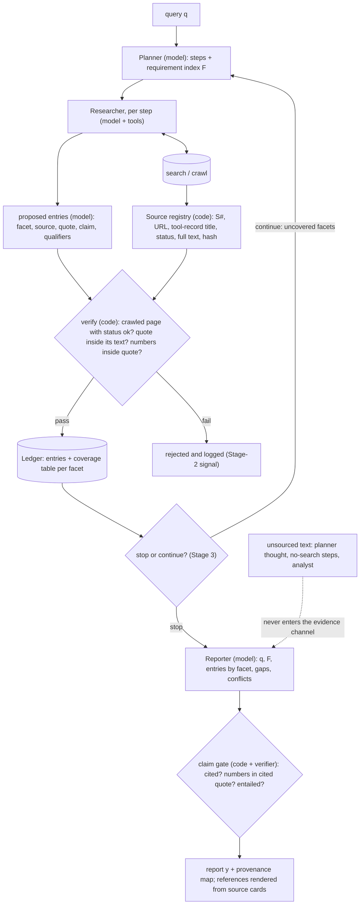

# Part 2 — Before end-to-end RL: make every claim traceable to a checked passage, then train only the handoff that still fails

Part 1 found two kinds of failure at the handoffs between roles: unsupported content entering the report by routes the reporter cannot check, and retrieved evidence lost before the reporter. A report-level judge cannot see where either happens. This part proposes what to do first. The best-supported first step is **provenance and precision control**: code that registers every tool output, keeps unsourced text out of the reporter's evidence, renders citations itself and checks each factual unit of the report against the passage it cites. The same machinery carries the evidence across the researcher → reporter handoff as a **requirement-indexed, source-linked ledger**; that the ledger also raises completeness is a hypothesis with a decisive test (§7). A role is trained only where the ledger shows a failure local to that role.

The proposal is a **preparatory stage for end-to-end (E2E) RL**. If it works, it may also make RL unnecessary for factuality.

**Where the evidence is.**
- Part 1 evidence IDs (E = archived record, K = pinned source line) resolve in `submission/evidence-index.md`.
- The pilot's code and raw outputs are in `part2_pilot/`. It was pre-registered in `docs/part2_protocol.md`, and its results are written up in `docs/part2_results.md`.
- The final report, supplied separately, is the canonical presentation of this design. This is the longer Part 2 answer; on 2026-10-02 it was aligned with the report.
- Paths under `docs/` name detailed notes in the full study archive, which this repository release omits. Among them, `docs/corrections.md` lists the statements corrected by the integrity review of 2026-10-01 and the alignment of 2026-10-02.

**Labels.**
- [brief]: the take-home PDF.
- [code]: DeerFlow `main-1.x` @ `2ab2876` (2.x @ `345f08b` only where stated).
- [P1]: observed in Part 1.
- [pilot]: observed in this part's pilot.
- [design]: a proposed design decision.
- [hyp]: a hypothesis to test.
- [inference]: derived from the evidence or assumptions stated alongside.
- [assumption]: an assumed value, not a measurement.
- [illustrative]: a constructed example. Toy passages are fictional and say so.

## 0. Summary

1. **Diagnosis [P1].**
   - Requirement-relevant text that a researcher received was lost before the reporter in 6 of 9 eligible runs (E11). Five of the six passages were search snippets and one was text from a crawled page; whether that passage could meet a requirement's acceptance criterion was not assessed.
   - Numbers written by steps that never searched reached the report 88% of the time, as often as numbers that retrieved text supports (E10, rechecked).
   - A real paper's URL was cited under an invented title, with findings the paper does not contain (E13, E21).
   - The reporter receives the planner's restatement of the user's query, never the query itself, the step list or the full tool outputs (K2).
   - Neither judge we could test checks claims against the passages they cite (K4, E16).
   - A lost passage appended raw at the end of the step's observation was stated in 2 of 15 samples (E13).

   E2E RL would therefore optimise a reward that cannot tell *which* handoff failed, or *whether* a claim is supported.
2. **Method [design]: one mechanism in two dependent stages, plus a separate decision study.**
   - **Stage 1, provenance controls and an evidence ledger (no training).** Its parts differ in how directly Part 1's data support them.
     - *Best supported, because they answer observed failures directly:* a source registry that owns every source identity; quarantine of unsourced text (planner thought, tool-less steps); references rendered by code from the cited sources; and a claim gate that checks each factual unit of the report (sentence, list item, table row, caption) against the passage it cites. Part 1 observed the failures these address: 93 of 132 report numbers in no retrieved text, relay of unsourced numbers, invented titles on real URLs, and, in the pilot, citation labels misused in 5 of 6 reports. The gate checks citations, numbers, titles and URLs by deterministic matching and deletes a unit that fails them. Each factual unit takes one of four claim forms: extractive, synthesis, derived number or conflict (§3.3). Two judgements are left to models, which can be wrong: which units are factual, and whether the passages *support* the unit. Both are audited. A unit judged only partly supported goes back once to the Reporter to be narrowed or split and is checked again; if it still fails, it is deleted, and the deletion is logged as lost coverage.
     - *A hypothesis to test:* that handing evidence across as verbatim, requirement-tagged quotes, with the tool-less recursion fallback replaced, raises completeness. Requirement-relevant text was lost in 6 of 9 runs, mostly search snippets, and restoring it rarely changed the report (2 of 15; pilot mixed), so the completeness benefit is what the fixed-retrieval handoff test in §7 (the final report's C1) can falsify.
   - **Stage 2, boundary-local training, run only if Stage 1's diagnostics call for it.**
     - It trains the Researcher's ledger output and/or the Reporter's grounded writing, as separate LoRA adapters on the shared base.
     - Supervision is SFT plus minimal-edit preference pairs defined on ledger units.
     - The pairs penalise false "no evidence" statements as well as invented claims, so leaving claims out does not pay.
   - **Stage 3, stop/continue.** It is studied separately, by paired branching from recorded pre-reporter states. That waits until the graph exposes the decision; the pinned graph never took it (K1, E1).
3. **Why this comes first [inference].** Stage 1 builds three things Part 1 §8 named as prerequisites for RL:
   - a factuality signal that checks every claim the detector finds against its cited passage, without sampling. Deterministic quote and number matching is combined with two fallible models, a claim detector and a support verifier, which must be validated against human labels;
   - separately measured indexing, transfer and uptake rates ($i$, $r$ and $w$; §3.6). As diagnostics, they make Part 1's multiplicative-credit problem observable;
   - a replayable state for the stop decision.
4. **Pilot [pilot].** A small, pre-registered reporter-replay pilot tested the design's most uncertain premise: will the reporter use a lost passage if it arrives as a requirement-tagged, source-labelled ledger entry rather than appended raw? The verdict was **mixed**, and presentation alone was not shown to fix nonuse. Both target entries quoted search snippets, which the proposed rules would not admit as evidence, and no arm wrote the fact into a summary's prose, so there was no positive control. The pilot did not test a functioning, checked ledger.
   - c03: the fact was stated in 0 of 3 ledger-form reports. The entry followed the step summary's References list.
   - c05: 2 of 3, against 1 of 3 with raw appending. This is weak, local evidence: one case, three seeds, a one-sample difference, and each positive ledger report was labelled by one model-based auditor. It is also narrow: it counts statements of the target fact, and both positive sentences carry an unsupported or questionable adjacent claim. One of them states only half the fact; without it, the verdict would be negative (§8).

   The ledger form also had three side effects:
   - every ledger-form report adopted `[S#]` citations, but 5 of 6 misused the labels;
   - in c03, all three ledger-form reports failed 6 of Part 1's 8 format checks;
   - a sourceless claim from the planner was attached to the restored source.

   These make code-rendered citations and the claim gate necessary, not optional (§8). Neither was implemented or tested in the pilot: they are proposed.
5. **What would make us drop it.** Suppose that, on the same recorded tool outputs, an annotator-built ledger gives supported coverage of the available requirements *equivalent* to the repaired handoff's: the 90% interval of the difference lies inside ±0.05 (§7.4–7.5). Then even an oracle handoff, with perfect selection and the ledger form, is not the lever, and the ledger is dropped as a completeness intervention; the provenance controls stay only if they raise precision. A difference that is merely not significant means only "no demonstrated gain": diagnose retrieval, indexing and the gate first.
6. **What advances to the benchmark.** G1 is advanced to one held-out benchmark run only if it meets the rule in §7.5: a coverage gain over G0, a gain over repairs alone (G0r), and non-inferiority on Factuality and Format. No benchmark score exists. The held-out run, not the internal rule, decides whether Format, Factuality and Completeness improve.

## 1. The problem this has to solve

**What the brief fixes [brief].**
- A Planner → Researcher(s) → Reporter loop, driven by one general-purpose LLM.
- The Reporter decides whether the evidence suffices, or sends control back to the Planner.
- A held-out benchmark, scored by an LLM-judge harness with one score per report on each of three axes:
  - Format/Style;
  - Factuality ("claims … supported by retrieved/citable evidence");
  - Completeness.
- The graph, tools, model and evaluation rubrics may all change.
- Human annotators are available, if their use is justified.

### 1.1 What Part 1 found

| Failure | Where it arises | Evidence | What a fix must do |
|---|---|---|---|
| Requirement-relevant text received, then lost before the reporter (five of the six passages were search snippets) | The researcher's free-text summary (3 runs); DeerFlow's recursion-limit fallback, which re-calls the model **without tools** and passes on the tool call it writes as text (3 runs) | E11; fallback fired 4 times, 3 strings (E8, K5). Whether the one crawled passage could meet an acceptance criterion was not assessed | Carry evidence across the boundary in a form code can check. The fallback is a code defect, fixable without learning |
| A lost passage, appended back raw, is rarely stated | Reporter, or the presentation | 2 of 15 samples; 0 of 30 without it; blinded audit 0 of 5 (E13). The block was appended at the end of the step's observation, after its References list in three of five cases, and no arm wrote the fact into the summary's prose | A better handoff must beat raw appending. Reporter nonuse may need training, or only a better placement |
| Unsupported numbers relayed | Tool-less analyst steps; researcher steps that never searched; the planner's "thought" | 93 of 132 report numbers in no tool output (E6). 88% relay from flagged no-search steps, as often as supported numbers, despite DeerFlow's warning in the input every time (E10, rechecked). 3 of 10 thoughts carried a sourceless figure (E24) | Keep unsourced text out of the evidence channel. A warning label is not enough |
| Real URLs under invented titles, carrying invented findings | A no-search step, then the reporter | c04 (E13, E21); 26 of 80 report URLs never retrieved (E6) | Code renders citations from tool records. Claims are checked against the **cited** passage, not the whole pool |
| The reporter sees only the planner's restatement of the query, and no step list | Graph | K2 | Give the reporter the query and an explicit requirement index |
| The judges miss all of this | Evaluation | In-repo judge sees no evidence (K4). Proxy checked 1 of 6 planted sentences (E16). Proxy completeness fell when invented numbers were removed (E20) | Check every claim against its cited passage. Completeness must not pay for invention |
| Stop/continue is never taken | Configuration | K1, E1 | Expose it, then study it separately |

### 1.2 What is hard here

- **The three axes are coupled through one path.** A claim helps Completeness only if it is specific, and Factuality only if it is supported. Today the loop produces specifics without support, and our proxy paid for them (E20).
- **The information needed to judge a claim is destroyed at the first handoff.** That information is which passage licenses the claim. The summary is free text, and the reporter sees neither the tool outputs nor the query itself, only the planner's restatement (K2). No later role, judge or optimiser can recover it.
- **Fixing one role may not change the report.** Along the evidence path, a fact reaches the report only if the researcher transfers it *and* the reporter uses it (Part 1 C1).

So the first job is to keep the claim–passage link intact and measurable. Optimising comes after that.

### 1.3 The chain from failure to falsifier

| Failure [P1] | Hypothesis [hyp] | Intervention [design] | Data or labels | Rule or objective | Decisive comparison | Result that falsifies it |
|---|---|---|---|---|---|---|
| Requirement-relevant text lost at the summary or the fallback (E11) | Free-text summaries and the tool-less fallback drop evidence the reporter would otherwise use | Verified ledger entries; fallback repair (C3, C5) | Oracle ledgers on the same tool outputs (§6.4, Task B) | §3.2 rule; transfer $r$ (§3.6) | H-oracle vs H-raw on the same tool outputs (C1); G1 vs G0 for the whole system (§7.1) | H-oracle's supported coverage of the available requirements is equivalent to H-raw's, within $\pm\delta_e$ (§7.5) |
| Delivered evidence not used (E13) | A presentation without the verbatim query or a requirement index causes nonuse | Query + requirement index + entries by facet (C7) | Pilot (§8); H-oracle | uptake $w$ | H-oracle vs H-oracle-raw (presentation, content fixed); H-oracle uptake; the stronger reporter on H-oracle | H-oracle ≈ H-oracle-raw (presentation adds nothing); or $w$ stays low with oracle ledgers, and then train W or change the model (§7.5) |
| Unsupported numbers relayed (E6, E10) | The reporter relays whatever its evidence channel carries | Quarantine (C6) + gate (C8) | Planted defects (§7.3) | g1–g5 | Support precision and unsupported numbers, G1 vs G0 | Precision does not rise, or rises only as supported coverage falls |
| Real URLs under invented titles (E13, E21) | Model-written citations come apart from their sources | Code-rendered references; g4, g5 | Planted misattributions | Detection ≥ 90% [assumption] | Misattributions, G1 vs G0 | Misattributions do not fall |
| Residual role-local failure after Stage 1 | A narrow, checkable target fixes one role | R and/or W adapter (§4) | §6 recipe | §4.2 losses | G2 / G3 vs G1 | $r$ or $w$ rises but supported coverage does not; or precision rises only through omission |
| Stop/continue untested (K1, E1) | Ledger coverage predicts the value of another round | Stage 3 rule (§5) | Paired branches | $\Delta(H)$ regression | Learned rule vs fixed policies, in G1-multi | The learned rule does not beat "always stop after round 1" on held-out queries |

## 2. Directions considered, and why one was chosen

| | D1. Ledger interface, no training | D2. Boundary-local training | D3. E2E RL now (or best-of-N distillation on judge scores) | D4. A stronger model | D5. Verify-and-revise the final report, with no ledger |
|---|---|---|---|---|---|
| Fit to Part 1 | High for unsourced relay and invented titles; a hypothesis for loss at the boundary and the missing query | High for what remains: reporter nonuse, researcher omission | Low: the reward cannot see the failures, credit is multiplicative, the stop decision does not exist | Partial: may reduce skipped searches and tool calls written as text. Does not fix structural losses (query never shown verbatim, DuckDuckGo hits never become citations [code, `extractor.py:86–96`], tools stripped in the fallback) | Partial: checks claims, but against the whole pool. Misses irrelevance and misattribution (E16). Cannot recover dropped evidence |
| Labels needed | None to run; audit labels to evaluate | Span and support labels, definable only once ledger units exist | Judge scores, which are not valid for factuality (E16, E20) | None | Verifier labels |
| Main failure modes | The reporter ignores entries; small models fail to fill the schema; the gate deletes coverage; more tokens | Learns to leave claims out; roles interfere; label noise | Learns to invent specifics (E20), skip search, pad | Cost; same structure | Deletes claims without restoring evidence |
| Cost | Engineering plus inference overhead | About 1.7k annotation hours [assumption]; small compute (§9) | Illustrative 2.3e20 FLOP, 516 days of sequential rollouts on our machine (Part 1 §7) | Inference price | Verifier calls |
| Can the mechanism be tested? | Yes, by replay at the boundary (Part 1's instrument) and oracle ledgers | Yes, per boundary | No: cannot tell which role changed | Yes, as an arm | Partly |
| Format / Factuality / Completeness | ↑ / ↑ / ? (↑ if recovered evidence is used; ↓ where the gate removes specifics a judge rewarded) | ~ / ↑ / ↑ if nonuse falls | ? / likely ↓ under the proxies we tested / ↑ by invention | ? | ~ / ↑ / ↓ |

**Choice.**
- **D1 is the main direction.** Its provenance controls answer failures Part 1 observed directly, and it is the cheapest change; its completeness benefit is the hypothesis §7 tests. It may be enough on its own; skipping it to reach training would be a mistake.
- **D2 is D1's conditional second stage.** Its labels ("is this claim supported by its evidence?") need the ledger's units, so it cannot come first. It runs only if Stage 1 leaves a measured, role-local failure.
- **D3 is deferred**, with explicit entry conditions (§7.5).
- **D4 becomes an experimental arm**: the same ledger with a stronger reporter.
- **D5 is absorbed**: the claim gate is post-hoc research-and-revise (RARR; Gao, Dai, Pasupat et al., 2023), with the ledger supplying the passage each claim cites.

**Two further alternatives that need the ledger's checks first.**
- **Distillation from a stronger teacher, verified by the ledger.** A stronger model writes the ledger entries and reports; the §3.2 rule and the gate's deterministic checks filter them; people audit a sample; the 4B roles are fine-tuned on what survives. This could replace much of the 945 hours of gold targets and pairs (§6.9) with teacher calls, at the price of teacher bias: the student learns the teacher's selection and paraphrase habits, and checks that verify quotes and numbers cannot catch a teacher's irrelevant or one-sided selection. It enters as an arm of Stage 2, a teacher-distilled adapter against the human-gold one, and is preferable whenever a teacher's outputs pass the checks at a high rate and the audited sample agrees with human labels at the §6.4 level.
- **Role-local RL with deterministic ledger rewards.** Each role is trained against its own checkable signal, for example verified entries per covered requirement for the researcher, minus rejected entries, or units the gate keeps for the reporter. This removes Part 1's credit problem without a report-level judge. It is deferred, because deterministic checks alone are gameable: they verify that a quote is verbatim and that its numbers match, not that it is relevant, so a policy can farm easy, verbatim, off-requirement entries. It becomes preferable to the preference objective of §4.2 once the support verifier and relevance labels are validated (§7.3) and on-policy exploration of extraction is what limits transfer $r$.

## 3. Stage 1: the evidence ledger

### 3.1 Information and decision flow



**What the model decides [design].** The requirement index; search queries; which spans to quote, and for which facet; how to paraphrase a quote into a claim; and how to write the report.

**What deterministic code decides.** Source identity and status; whether a quote is verbatim; whether a claim's numbers appear in its quote; coverage and conflict flags; citation rendering; and the gate's deterministic checks (g1–g3, g5).

**What stays a fallible model judgement.** Whether a cited quote semantically *supports* a sentence (g4) is decided by a model verifier. It can be wrong, and its error rates must be measured against human labels (§6.4, §7.3).

### 3.2 The unit: one ledger entry

**An entry, and what it may quote [illustrative].** Entries are labelled `V#` (verified entry), so they cannot be confused with Part 1's evidence IDs (E#). The pilot's template, written before this choice, labelled its single entry `[E1]`. The record below is conditional. It shows what Part 1's c03 passage (run q05-r02) would become *if* its page had been crawled and contained the sentence. The run never crawled that page: it received only a search snippet, and a snippet is a lead, not evidence (below). The quote reproduces the recorded snippet's text, including its spacing. The facet IDs are Part 1's checklist IDs.

```json
{"entry_id": "V7", "facet": "R7", "source": "S12",
 "quote": "using 8 - bit integers (INT8) can nearly double the throughput of matrix multiplications compared to using 16- bit floating-point numbers (FP16)",
 "claim": "INT8 can nearly double matrix-multiplication throughput relative to FP16 (the page's statement; no method, model or hardware given).",
 "qualifiers": {"metric": "matmul throughput", "comparison": "INT8 vs FP16", "method": "not stated", "model": "not stated", "hardware": "not stated"},
 "stance": "supports", "hedge": "nearly",
 "status": {"verified": true, "conflict": null, "sources_on_facet": 1}, "added_by": "researcher, step 0"}
```

- **The facet is R7, not R5.** q05's R5 asks for "speedup or memory numbers with conditions, attributed to sources". The sentence names no method, model or hardware, so it bears on R7, the weight-only against weight-and-activation distinction, and could not complete R5.
- **`span`**, omitted here, gives the quote's character offsets in its card's text. No crawled page was recorded, so there are none to give.
- **`status`** records three things code computes: verification, any conflict with another entry on the facet, and how many independent sources the facet has.
- **The source card** `S12` would be `{url: sherlock-dev.netlify.app/posts/2023-10-02-llm-quant/, title: "LLM Quantization Review | Bitter Lesson", kind: page, tool: crawl, run_id, tool_call, status: ok, fetched_at, sha256, text}`. Code writes every card from the tool record, never a model. In the recorded run, the only card for this URL would be a `kind: snippet` card from the search, which no entry may quote.
- **What the recorded run gets instead.** R5 has no admissible entry. The snippet is a lead, and the run's one crawl of a paper on these methods (SmoothQuant, on arXiv) returned a 403 error. Code adds a gap marker for R5, and the report states the gap in code's fixed wording (§3.3). The final report's Table 4 works through this case.

**Verification rule [design].** Let $\mathrm{norm}(\cdot)$ fold Unicode, dashes, quotation marks and whitespace (Part 1's `_norm`). An entry $e$ with quote $u_e$, claim $c_e$ and source card $s_e$ is accepted iff

$$
\mathrm{ok}(e)=\mathbb 1\big[\mathrm{norm}(u_e)\sqsubseteq\mathrm{norm}(\mathrm{text}(s_e))\big]\cdot\mathbb 1\big[\mathrm{kind}(s_e)=\text{page}\wedge\mathrm{status}(s_e)=\text{ok}\big]\cdot\mathbb 1\big[\mathrm{nums}(c_e)\subseteq\mathrm{nums}(u_e)\big]\cdot\mathbb 1\big[f_e\in F\big]\cdot\mathbb 1\big[|u_e|\le 600\big].
$$

- $\sqsubseteq$ means "is a substring of". $\mathbb 1[\cdot]$ is 1 if the condition holds and 0 otherwise. $\mathrm{nums}(\cdot)$ is the set of numbers with units, compared with Part 1's rounding tolerance (`item_present`).
- **In words**: the quote must come from a crawled page, not a search snippet, and really be in it; the page must be real content, not an error, block or CAPTCHA; the paraphrase may not add numbers; the facet must exist; and the quote must be a passage, not a dumped page.
- The match is strict. Part 1's judge-quote rule tolerated 20% token mismatch, and that would let a sharpened paraphrase through.
- **Without the third factor**, a researcher could quote "nearly double" and claim "2.3×".
- **Without the second**, a search snippet, a fragment of a page no one read, could become evidence, and so could the CAPTCHA page and the Jina 403 error text that Part 1 handed to researchers as page content (`docs/part1_results.md` §3). Five of Part 1's six lost passages were snippets (E11).

### 3.3 Components

Components are numbered C1–C8 in this section. The written report numbers its experimental contrasts C1–C6 instead, and Part 1 numbers its challenges C1–C7.

| Component | In → out | Code does | Model decides | How it fails or is gamed |
|---|---|---|---|---|
| **C1 Requirement index** | $q\to F$ = facets `{id, text, kind, evidence_type}` | Validates JSON, caps at 10 facets. After a second parse failure, falls back to a single facet ($q$ itself): an unparsed first plan ends DeerFlow's run with no report (K11) | The decomposition, including `implicit` facets (caveats, a judgement) | Missing facets (Part 1's M1). Measured as indexing $i$ and index recall (§3.6), via annotators' mapping to a separately written checklist that the system never sees |
| **C2 Source registry** | Every tool output → card `S#` | Records the card's kind (search snippet or page), URL, the tool record's title, domain, tool, query, time, HTTP status, full pre-truncation text, hash. Sets status ∈ {ok, error, blocked, captcha, empty, non_html} by rules ("Are you a robot", "AbuseAlleviationError", HTTP codes). Wraps the background search, which is unguarded in 1.x (K6), and registers its results as cards | Nothing | None by the model. Code errors are caught by tests on recorded runs |
| **C3 Entries** | Step's tool outputs + $F$ → proposed entries → verified entries | §3.2 rule. Rejections are logged with a reason (`QUOTE_NOT_FOUND`, `CLAIM_NUMBER_NOT_IN_QUOTE`, …) | Span, facet, paraphrase, qualifiers, stance | Quote-dumping: capped at 600 characters, and entry precision is audited. Mis-tagging an irrelevant passage: measured as entry precision. In the pilot, the reporter ignored one mis-tagged entry (LC, n = 1, §8) |
| **C4 Coverage and conflicts** | Ledger → per-facet table | status ∈ {covered, searched-no-evidence, search-failed, not-searched, budget-exhausted}; entry and source counts. Conflict flag (below). A facet left with no accepted entry at the end of the run gets a typed **gap marker**: its reason and its scope, the cards recorded for this run | Nothing | Code cannot see a conflict for which it has no qualifiers. The audit catches these |
| **C5 Fallback repair** | Researcher hits its recursion limit | Keeps verified entries. Lists the step's unprocessed cards and marks the facet `budget-exhausted`. Optionally one schema-constrained extraction call; anything that is not valid entries JSON is discarded. Never re-calls the model without tools (K5) | Optional extraction | None new |
| **C6 Quarantine** | Planner thought, outputs of no-search steps, analyst text | Kept out of the reporter's evidence channel. The reporter gets $q$ and $F$ in place of the thought. Analysis becomes the reporter's job, under the gate | Nothing | Coverage may fall where unsourced text had "completed" a facet. That is measured, not hidden (§7.2) |
| **C7 Reporter** | $q$, $F$, entries by facet (quote, claim, qualifiers, card summary), coverage, conflicts → report with inline `[V#]` | Assembles the input. Writes no References section | Structure, synthesis, which entries to use. Each factual unit takes one of the four claim forms below; gaps are cited by their markers, not written | **Label misuse, observed in the pilot** (5 of 6 ledger-form reports, §8), so code renders references and C8 checks every label. Also citation spraying, vague sentences that avoid checkable content, and parroting mis-tagged entries. All are measured (§7.2) |
| **C8 Claim gate** | Report → gated report + provenance map | Splits the report into **units**: prose sentences, list items, table rows, figure captions and headings. Every unit the claim detector marks factual gets four deterministic checks: (g1) does it cite at least one entry? (g2) does every cited `[V#]` exist? (g3) does its claim record pass the exact checks for its form: every number and unit in a cited quote, or recomputed from cited inputs for a derived number? (g5) do its titles, URLs and image links match a card? **A factual unit that fails any of g1–g3 or g5 is deleted, whatever its form.** A table row is deleted whole; an image goes with its caption. A gap sentence survives only if its marker exists and the facet still has no accepted entry; code renders it in a fixed form ("The sources recorded for this report yielded no checked evidence for R5"), so it describes the recorded pool, not the web. A model-written claim that evidence is missing has no entry to cite, so g1 deletes it. Headings may not carry claims: a heading the detector marks factual is replaced by the plain name of its facet, so the structure survives. Renders References from the cards actually cited | **The claim detector** (rules plus a model) marks units factual: a number, a named source or method with a predicate, a comparison, or a claim about the world. **(g4) The semantic verifier** labels whether the cited quotes support the unit: SUPPORTED / PARTIAL / NOT_SUPPORTED / MISATTRIBUTED. NOT_SUPPORTED is deleted. MISATTRIBUTED is re-cited if exactly one entry supports the unit, otherwise deleted. PARTIAL goes back once to the Reporter, which narrows the unit to what its entries support or splits it into separately cited units; the result is checked again from the start, and a unit still PARTIAL or NOT_SUPPORTED is deleted | **Two steps are fallible models:** the claim detector can miss a factual unit, which then survives unchecked, and g4 can mislabel support. g1–g3 and g5 are exact matching. Detector misses are audited by humans, as $P(\text{factual}\mid\text{detector says non-factual})$ (§3.4, §7.3); g4 is validated against Task C labels (§6.3–6.4). Both are proposed and unbuilt. Deletions can cut coverage: every narrowing and deletion is logged, and each deletion counts as lost coverage for its facet. If a facet with accepted entries loses all its units, code renders a scoped line, "No checked statement about R5 was retained", which does not claim that evidence is missing |

**The situations the brief's loop meets, and how each is handled.**

| Situation | Handling | Where |
|---|---|---|
| Missing information (no evidence for a facet) | Status `searched-no-evidence` or `not-searched`, and a typed gap marker. The reporter cites the marker; code renders the gap sentence in a fixed form scoped to the recorded sources. Gap honesty is scored, and so are false gaps | C4, C7, C8, §3.6 |
| Contradictory evidence | Flagged when entries on one facet give numbers for the same metric that differ beyond tolerance, or an entry's stance is `contradicts`. The reporter writes a conflict record: both entries and the condition under which they differ, with no single value asserted. Collapsing the conflict is a hard negative (§6.5) | C4, C7 |
| Failed search | Error card; the facet becomes `search-failed`, which differs from "searched, nothing found". An error card cannot back a claim | C2, C4 |
| Truncated page | The card keeps the full text and records the window the model saw. Quotes are verified against the full text. Facet-conditioned windows (in place of the first 1,000 characters, E9) are a separate arm, because they add evidence | C2 |
| Recursion fallback | No tool-less re-call. Verified entries are kept; the unprocessed cards are listed; the facet is marked `budget-exhausted`. In Part 1's three collapsed steps (q06, q08, q03-r02), the steps' cards would have stayed listed instead of becoming 104–138-character tool-call strings (E8). Only q08's vector-database benchmark was a crawled page that could be quoted; the Hyper-RAG and TurboQuant items were search snippets, which would be listed as leads | C5 |
| Invented URL | It has no card, so it cannot be cited. A unit that contains a URL, title or image link matching no card fails g5 and is deleted, an image together with its caption | C2, C8 |
| Citation error (unsupported, wrong entry, wrong title) | g2: the cited entry exists (deterministic). g5: the title matches the card (deterministic); c04's invented title fails g5, so its sentence is deleted. g4: semantic support, with re-citation when exactly one entry supports the unit (a fallible model) | C8 |
| A step that never searched | It has no tool outputs, so it yields no entries and its text cannot carry numbers onward. In Part 1, 47 of the 93 unmatched report numbers first appeared in such steps (E6) | C3, C6 |

**Claim forms [design].** Each factual unit takes one of four forms, and code checks each record exactly.
- **Extractive:** one claim, citing one entry ("the Hyper-RAG authors report …").
- **Synthesis:** a comparison or inference across entries. The record lists every supporting entry, the comparison or inference drawn, its qualifiers and a citation to each entry, so qualified analysis can rest on several sources at once ("two of three sources report …").
- **Derived number:** the record holds the input entries, their quantities and units, and a calculation from a fixed set (ratio, difference, percentage change), which code recomputes. The pilot's unmarked "5.3×", computed as 16/3 from a quote that also says 32 bits, has no such record, so the gate would delete it (§8). The gate was not implemented in the pilot.
- **Conflict:** the record names the incompatible entries and the condition under which they differ, and asserts no single value.

Code checks that the cited entries exist, that every number occurs in a cited quote or recomputes from cited inputs, and that units agree. Whether the entries support the claim, alone, jointly or through a calculation, is left to the verifier (g4) and the audit: matching quotes and numbers never guarantees semantic support.

*A hypothetical example; all three entries are invented, because the recorded q05 pages contain no such figures.* Suppose V1 quotes a paper reporting that 4-bit GPTQ runs 2.0× faster than FP16 at batch size 1 on a given GPU, V2 quotes another paper reporting 3.0× for 4-bit AWQ in the same setting, and V3 quotes a blog reporting no AWQ speedup at batch size 64. The synthesis claim "at batch size 1, both methods are reported faster than FP16, AWQ more so (3.0× against 2.0×) [V1, V2]" passes code, because both entries exist, are cited and contain its numbers; the verifier must still judge whether the two papers' settings are comparable. The derived number "AWQ's reported speedup is 1.5 times GPTQ's [V1, V2]" records the inputs 3.0 and 2.0 and the ratio, which code recomputes. The disagreement between V2 and V3 is recorded as a conflict whose condition is batch size, so the report states both values instead of choosing one.

**The Reporter may not:**
- state a number that is in none of its cited quotes and is not a recorded derivation;
- infer a source's content from its title or URL. This is exactly c04, where the report attributed to a *Nature Communications* DOI findings its page never stated (E13, E21);
- compare numbers from entries whose metric, dataset or hardware qualifiers differ without a comparability caveat. `docs/part1_analysis.md` §4 shows how a table of individually cited cells can still imply an invalid comparison.

**A retrieved page is evidence of what the page says, not that its claim is true.**
- Verification establishes attribution only.
- Cards carry a source type (peer-reviewed, preprint, vendor documentation, blog, forum or social post), set by domain rules and refined by the model.
- When a key claim rests on a single non-primary source, the reporter must name the type. Part 1's TurboQuant passage came from a LinkedIn post (c05).
- Source type never changes whether a quote verifies.

### 3.4 Traceability, and why the gate does not dilute

**Traceability, and its limit.** Every surviving unit *that the claim detector marks factual* carries a provenance chain:

$$\text{unit}\to[V\#]\to(\text{facet},\ \text{quote},\ \text{span offsets})\to S\#\to(\text{run\_id},\ \text{tool-call index},\ \text{URL},\ \text{sha256})\to\text{raw tool record}.$$

It is emitted as JSON with the report. An auditor can then go from such a unit to the bytes a tool returned, which Part 1 needed a separate, blinded model-based audit to do (E21).

**Guaranteed by deterministic matching:**
- the chain exists;
- each cited quote is verbatim in recorded tool text;
- the unit's numbers, titles and URLs match its cited quotes and cards, and any derived number recomputes from its cited inputs.

Gap sentences and scoped lines have no quote; code renders them only through the marker checks of C8.

**Not guaranteed:**
- that the quote *supports* the unit. That is g4, a fallible verifier: dropping a hedge or widening a claim's scope passes the exact checks;
- that every factual unit was detected. A missed one survives without a chain.

So the guarantee is narrower than "every claim is traceable". Two separate quantities are measured (§7.3):
- **$P(\text{factual}\mid\text{detector says non-factual})$**: humans label a random sample of surviving units that the detector marked non-factual, and the share that make a checkable claim is reported with its interval;
- **planted-claim sensitivity**: the share of planted uncited claims (nonnumeric prose, a table row, a caption) that the detector marks factual.

**No dilution.** The gate checks every detected factual unit, so $k=N$ in Part 1's dilution analysis (C2). That removes sampling dilution, but not model error: the claim detector can miss a unit, and the semantic support check (g4) can mislabel one. A per-error penalty with every claim checked charges each false claim the same, however long the report. A proxy that samples at most 10 "central" claims does not (E16).

### 3.5 Pseudocode

```python
def research_step(q, F, step, registry, budget):
    entries, rejected = [], []
    for turn in react_loop(step, tools=[search, crawl], limit=budget):     # model: tool calls
        for out in turn.tool_outputs:
            registry.add(card_from(out))                                    # code: S#, status, full text
    proposed = model.extract_entries(q, F, step, registry.cards(step))      # model: spans, facets, claims
    for e in parse_entries(proposed):                                       # invalid JSON -> []
        (entries if ok(e, registry, F) else rejected).append(e)             # code: §3.2 rule
    if budget_exhausted(step):                                              # replaces the tool-less re-call (K5)
        mark_facets(step, "budget-exhausted"); list_unprocessed(step, registry)
    return entries, rejected

def run(q):
    F = planner.requirement_index(q) or [Facet("F1", q)]                    # fallback instead of ending the run (K11)
    ledger, registry = Ledger(F), Registry()
    while True:
        for step in planner.steps(q, F, ledger.coverage()):
            ledger.add(*research_step(q, F, step, registry, budget=25))
        if stop_policy(ledger.state()) == "stop": break                     # Stage 3; fixed rule until then
    draft = reporter.write(q, F, ledger.by_facet(), ledger.coverage(), ledger.conflicts())
    report, provenance, log = claim_gate(draft, ledger, registry, detector, verifier)  # g1-g3, g5 exact; detector, g4 models
    return render_references(report, registry), provenance, log
```

### 3.6 What the ledger makes measurable

**The sets [design].** Take one run, with tool outputs $O$.
- **$F^\star$** is the evaluation checklist, written by annotators who never see the system's output (Task A). Each facet is tagged **evidence**, answerable from quotable passages, or **synthesis**, a judgement, recommendation or caveat that must be reasoned from evidence. $F^\star_{\text{ev}}\subseteq F^\star$ is the evidence part.
- **$F$** is the system's own requirement index, written by the Planner (C1).
- **$M\subseteq F\times F^\star_{\text{ev}}$** is a mapping that annotators draw from the facet texts alone (Task A). $(f,f^\star)\in M$ when system facet $f$ asks for what $f^\star$ asks for. It may be many-to-many.
- **$L^\star(O)$** is the **oracle ledger**: every admissible entry annotators can extract from the *same* outputs $O$, quoting crawled pages with status "ok" and never search snippets, tagged with $F^\star$ facets (Task B). Each facet also has an **acceptance criterion** (Task A): what a sufficient answer must contain.
- **$L$** is the system's ledger, tagged with $F$ facets, and **$y$** the gated report.

**Four nested subsets of $F^\star_{\text{ev}}$.**
- **Available**, $A=\{f^\star:$ the entries of $L^\star_{f^\star}$ meet $f^\star$'s acceptance criterion$\}$: the run's tool outputs hold admissible evidence sufficient for $f^\star$. A query is **eligible** for the fixed-retrieval handoff test if $A\neq\emptyset$ (§7.1).
- **Indexed**, $I=\{f^\star\in A:\ (f,f^\star)\in M$ for some $f\in F\}$: the Planner's index asks for it.
- **Transferred**, $T=\{f^\star\in I:$ some entry of $L$ under a facet $f$ with $(f,f^\star)\in M$ preserves the facet-relevant fact of an oracle entry for $f^\star\}$: the Researcher's ledger kept it.
  - *Preserves* means the entry's quote, from the same card, contains the oracle entry's **core span** verbatim, after §3.2's normalisation. The core span is the minimal set of words that state the fact, marked by annotators (Task B).
  - Sharing the card, or overlapping only part of the span, is not enough.
- **Used**, $U=\{f^\star\in T:\ y$'s supported units citing such entries meet $f^\star$'s acceptance criterion$\}$: the Reporter used it, with support. PARTIAL, NOT_SUPPORTED and undetected units never count. A model requirement judge, validated against people first, labels each facet full, partial or absent; only full counts (§7.2–7.3).

**The identity.** Because $U\subseteq T\subseteq I\subseteq A\subseteq F^\star_{\text{ev}}$, the fractions telescope:

$$
\underbrace{\frac{|U|}{|F^\star_{\text{ev}}|}}_{\text{supported coverage}}=\underbrace{\frac{|A|}{|F^\star_{\text{ev}}|}}_{a:\ \text{availability}}\cdot\underbrace{\frac{|I|}{|A|}}_{i:\ \text{indexing}}\cdot\underbrace{\frac{|T|}{|I|}}_{r:\ \text{transfer}}\cdot\underbrace{\frac{|U|}{|T|}}_{w:\ \text{uptake}}.
$$

- **In words.** Of the evidence facets the query needs:
  - $a$ is the share for which research retrieved usable evidence;
  - $i$, the share of those that the Planner's index asked for;
  - $r$, the share of those that the Researcher's ledger kept;
  - $w$, the share of those that the Reporter stated with a supported citation.
- **Zero denominators.** If $A=\emptyset$, then $i$, $r$ and $w$ are undefined. If $I=\emptyset$, $r$ and $w$ are; if $T=\emptyset$, $w$ is.
  - Undefined factors are reported as "n/a", never as 0 or 1.
  - Across queries, each factor is pooled as a ratio of summed counts, e.g. $r=\sum_q|T_q|/\sum_q|I_q|$, with the number of contributing queries shown. The pooled factors still multiply to pooled supported coverage.
- **What the nesting hides.**
  - $I\subseteq A$ by construction. So an unindexed facet for which nothing was retrieved is booked under $a$, even if the missing index entry is *why* nothing was searched. **Index recall** over all of $F^\star_{\text{ev}}$ is therefore reported separately, as a Planner diagnostic.
  - A supported unit that covers $f^\star$ through an entry filed under an unmapped facet counts for Completeness, but not in $U$. It is reported as a cross-facet use.
- **Diagnostics, not causal effects.** The factors describe where coverage was lost in a run. They do not say what fixing one boundary would gain: indexing a facet changes what is searched, so it can move $a$ too. Causal claims come only from the matched comparisons in §7.1.
- **A worked example [illustrative].**
  - A query has 8 evidence facets.
  - The run's tool outputs hold usable evidence for 5 of them, so $a=5/8$.
  - The Planner's index asks for 4 of those 5: $i=4/5$.
  - The ledger keeps verified entries for 3 of the 4: $r=3/4$.
  - The report states 2 of the 3 with supported citations: $w=2/3$.
  - Supported coverage is $2/8=0.25=\tfrac58\cdot\tfrac45\cdot\tfrac34\cdot\tfrac23$. Most is lost at retrieval; indexing, transfer and uptake each lose one facet.
- **Synthesis facets.** Facets in $F^\star\setminus F^\star_{\text{ev}}$ (e.g. q01's "justified judgement of which approaches are most promising") have no quote to transfer, so they are kept out of the product. They are scored separately (Task D): addressed or not, and whether each premise of the judgement cites a supported entry.
- **Link to Part 1.** Part 1 modelled $P(F\text{ in report})=p_Rp_W$ (C1). Here $r$ and $w$ are its measured, per-facet counterparts. They are used to decide which role, if any, to train (§4, §7.5).
- **The precision side** is measured separately:
  - support precision, the share of factual units labelled SUPPORTED by their cited quotes. In ungated reports PARTIAL counts as unsupported, and its share is reported separately; in gated reports the narrowings and deletions per facet are reported instead;
  - citation precision (ALCE; Gao, Yen, Yu & Chen, 2023);
  - unsupported precise numbers;
  - misattributions;
  - the claim detector's $P(\text{factual}\mid\text{detector says non-factual})$ and planted-claim sensitivity (§3.4, §7.3).
- **Gaps are scored both ways:**
  - **gap honesty**: the share of facets in $F^\star_{\text{ev}}\setminus A$ that the report states as uncovered;
  - **false gaps**: a gap marker or gap statement is false when the oracle ledger holds an admissible entry for that facet in the same outputs. The false-gap rate is reported for every arm that states gaps.
- **No composite.** None of these is merged into one score. A shorter report that drops hard facets raises precision while lowering $|U|$, and both are visible. Wei et al. (2024) make the same point for long-form factuality, balancing precision against a recall term so that shorter is not automatically better.

## 4. Stage 2: boundary-local training (conditional)

**When it runs.** Only if Stage 1's measurements show a residual, role-local failure (§7.5):
- low indexing $i$ → fix the Planner's index first, by prompt or schema (the Planner is not trained in Stage 2);
- low transfer $r$ at fixed retrieval (H-sys against H-oracle, §7.1) → train the Researcher;
- low uptake $w$, or low precision, *given* an oracle ledger (H-oracle, §7.1) → train the Reporter.

If none applies, Stage 2 is skipped. The factors are diagnostics (§3.6), so a trigger names where to look first; the matched comparisons in §7.1 confirm whether fixing that boundary helps.

### 4.1 What is trained and what stays fixed

| Decision | Trained? | Input $x$ | Output $y$ |
|---|---|---|---|
| **R: Researcher ledger output** (one call per step) | yes, adapter $\phi_R$ | $q$, $F$, step text, the step's source cards (model-visible text) | entries JSON, plus explicit "no evidence in these sources for $f$" markers |
| **W: Reporter** | yes, adapter $\phi_W$ | $q$, $F$, entries by facet, coverage, conflicts | report with `[V#]` |
| Researcher tool use (queries, crawl choices) | no | — | Needs interaction with the environment. Left to later RL in the frozen corpus |
| Planner, requirement index, coordinator | no | — | Measured: indexing $i$ and index recall (§3.6), and parse rate. A low $i$ is fixed by prompt or schema first |
| Stop/continue | no | — | Stage 3 fits a separate estimator |
| Claim detector and semantic verifier (g4) | not in Stage 2: trained before it, then frozen | — | Trained on independently labelled units from **baseline** reports (Task C). Frozen before any W training. Tested on human-labelled units from W outputs on disjoint queries, and never updated on W outputs, so the writer and its checker cannot co-adapt. Proposed; not built or validated in the pilot |

**Backbone and interference [design].**
- One shared, frozen base model with separate LoRA adapters, $\phi_R$ and $\phi_W$ (Hu et al., 2022). The graph selects the adapter per role; untrained roles run the base unchanged.
- **Why.** Interference cannot happen, because no trainable parameter is shared. Each ablation also changes exactly one role.
- **Cost.** No transfer between roles, and the serving stack must support several adapters on one base (Sheng et al., 2024).
- **If the lab must serve one set of weights.** Use a single adapter, with the role-weighted loss below and per-role regression suites: plan-parse rate, tool-call validity, entry validity, report format. Conflicting gradients between roles are the risk Part 1's analysis noted (`docs/part1_analysis.md` §5.5), using PCGrad's definition of conflict (Yu et al., 2020).

### 4.2 Objective

**Notation.** For role $r\in\{R,W\}$, $\pi_{\phi_r}(y\mid x)=\prod_{k=1}^{|y|}\pi_{\theta_0,\phi_r}(y_k\mid x,y_{<k})$ is the base model $\theta_0$ with adapter $\phi_r$. The loss covers only target tokens $y$. Everything in $x$ — tool outputs, quotes, cards — is context, masked out of the loss (as in Search-R1's retrieved-token masking; Jin et al., 2025).

**Stage 2a: supervised fine-tuning on adjudicated targets.** $\mathcal D_r^{\text{SFT}}=\{(x_n,y_n)\}_{n=1}^{N_r}$.

$$
\mathcal L_{\text{SFT}}(\phi_r)=-\frac{1}{N_r}\sum_{n=1}^{N_r}\frac{1}{|y_n|}\sum_{k=1}^{|y_n|}\log\pi_{\phi_r}(y_{n,k}\mid x_n,y_{n,<k}).
$$

- **What it does.** It raises the probability of the gold output, token by token.
- **The $1/|y_n|$ factor** makes each example count once, whatever its length. With a sum over tokens instead, a 3,400-token report (the mean report length, `docs/part1_results.md` §2) would weigh as much as about seven 500-token extractions. That matters only with a shared adapter (below).
- **Without Stage 2a,** the reference model for Stage 2b would be the untrained base. Part 1's 4B base writes tool calls as text (E8), so preference pairs would then mostly teach format, not the defect.

**Stage 2b: preference on minimal-edit pairs, with an anchor.** $\mathcal D^{\text{pair}}_{r,d}=\{(x,y^+,y^-)\}$, where $y^-$ is $y^+$ with exactly one defect of type $d$ (§6.5).

$$
\mathcal L_{\text{pref}}(\phi_r)=\mathbb E_{d\sim\mathrm{Unif}(\mathcal D_r)}\ \mathbb E_{(x,y^+,y^-)\sim\mathcal D^{\text{pair}}_{r,d}}\Big[-\log\sigma\big(\beta\,[h_\phi(x,y^+)-h_\phi(x,y^-)]\big)\;-\;\frac{\alpha}{|y^+|}\log\pi_{\phi_r}(y^+\mid x)\Big],
$$

$$
h_\phi(x,y)=\log\pi_{\phi_r}(y\mid x)-\log\pi_{\text{ref}}(y\mid x).
$$

**Symbols.**
- $\pi_{\text{ref}}$ is the frozen Stage-2a model, and $\sigma(z)=1/(1+e^{-z})$.
- $\beta>0$ sets how far the policy may move from $\pi_{\text{ref}}$. Small $\beta$ allows large moves.
- $\alpha\ge0$ weights the anchor.
- $\mathrm{Unif}(\mathcal D_r)$ samples each defect type with equal probability, however many pairs it has.

**Where the first term comes from.** This is DPO (Rafailov et al., 2023), and the derivation in plain words:
1. For each input $x$, maximising $\mathbb E_{y\sim\pi(\cdot\mid x)}[\rho(x,y)]-\beta\,\mathrm{KL}\big(\pi(\cdot\mid x)\,\Vert\,\pi_{\text{ref}}(\cdot\mid x)\big)$ over $\pi$ has the solution $\pi^\ast(y\mid x)=\pi_{\text{ref}}(y\mid x)\exp(\rho(x,y)/\beta)/Z(x)$, where $Z(x)$ normalises over $y$.
2. So $\rho(x,y)=\beta\log\frac{\pi^\ast(y\mid x)}{\pi_{\text{ref}}(y\mid x)}+\beta\log Z(x)$.
3. Assume a preference follows the Bradley–Terry model, $P(y^+\succ y^-)=\sigma(\rho(x,y^+)-\rho(x,y^-))$. Then the normaliser $Z(x)$ cancels in the difference.
4. Maximising the likelihood of the observed preferences, with the policy in place of $\pi^\ast$, gives the first term.

The term raises the log-probability of $y^+$ relative to $y^-$, each measured against the reference.

**Why minimal-edit pairs assign credit locally.** Write $y^\pm=(u,e^\pm,v)$, with a shared prefix $u$, the edited span $e^\pm$ and a shared suffix $v$.
- The prefix terms of $h(y^+)$ and $h(y^-)$ are identical, so they cancel *exactly*.
- The suffix terms cancel only approximately, because their contexts differ.
- So the gradient lands on the defect and what follows it. One report-level scalar, by contrast, multiplies every token of every role (Part 1 §2).

**The second term (an anchor) keeps $\log\pi(y^+)$ from falling.** DPO can satisfy a preference by pushing both outputs down, as long as $y^-$ falls faster. Pang et al. (2024) found that an NLL term on the winners was crucial in their setting.

**The risk of near-identical pairs.** Pal et al. (2024) show that the DPO loss can lower the likelihood of the preferred output while the preference margin still grows, and observe it especially on datasets whose paired outputs differ by a small edit distance, as these pairs do by construction. The mechanism here is an inference: minimal edits make the pair's log-ratio difference depend on a few tokens, so the loss can be driven down quickly by moving the probabilities of those tokens and of the suffix that follows them, whose context differs between $y^+$ and $y^-$. Two failure modes follow. The likelihood of $y^+$ itself can fall, because its suffix shares most tokens with $y^-$'s; and the adapter can learn the surface form of an edit (avoid "×", avoid a template phrase) rather than the defect. The anchor addresses the first, the direction-balanced families and the cue-only test (§6.6) the second. Each checkpoint also reports the average log-likelihood of held-out gold outputs relative to the Stage-2a model, and training stops when it falls by more than a pre-declared margin [assumption].

**What breaks if a term is removed.**

| Removed | Consequence |
|---|---|
| Stage 2a (SFT) | The reference cannot produce valid entries or `[V#]` citations, so the pairs teach format instead of the defect |
| DPO term | No contrast on confusable cases: nothing teaches that "2.3×" is worse than "nearly double" when both read fluently |
| Anchor ($\alpha=0$) | Likelihood of good outputs can fall, degrading the shared text |
| **False-gap pairs** | The cheapest way to avoid unsupported claims is to say less. Precision rises while transfer and uptake fall: the omission failure below |
| Uniform sampling over defect types | The commonest defect (omission) dominates |
| Large $\beta$ / small $\beta$ | Too little effect / drift and over-fitting of the pair signal: an analogue of reward over-optimisation (Gao, Schulman & Hilton, 2023) |

**With a single shared adapter,** $\mathcal L=\sum_r\rho_r\mathcal L_r$ with fixed $\rho_R=\rho_W=\tfrac12$. Each role then contributes a fixed share per batch, so long reporter examples cannot drown short extraction examples.

### 4.3 Why training cannot win by leaving claims out, and what happens when the target is unknown

**Guards against omission [design].**
1. **Every "stay silent" lesson has a mirrored "say it" lesson.** Pairs that penalise an invented claim (y⁻ adds a figure to a facet whose status is `search-failed`) are matched with pairs that penalise a **false gap** (y⁻ says "no evidence was found" for a facet that has entries) and **nonuse** (y⁻ drops a supported sentence).
2. **Evaluation** reports $i$, $r$, $w$ and supported coverage next to precision (§3.6).
3. **The go/no-go rule rejects a precision gain** that comes with a supported-coverage loss larger than 2 points (§7.5).

**When the target is genuinely unknown.**

| Situation | Target |
|---|---|
| No evidence in the corpus | The facet's gap marker, cited; code renders the sentence. This is a positive example |
| Evidence conflicts | A conflict record: both entries and the condition under which they differ |
| The subject of a figure is unclear (e.g. "Reduces hallucinations by 30–50% in controlled studies", from a prompt-engineering blog post; Part 1 c04, seg 1.1) | No entry. If it is used at all, it must be described as unclear |
| Annotators cannot agree whether a quote supports a claim | Excluded from training and counted. If over 10% of a facet type is excluded, the guideline is revised [assumption] |

## 5. Stage 3: stop/continue, from paired branches

**No observation exists here [P1].** The pinned graph never took this decision: with `max_plan_iterations = 1` it goes to the reporter after one plan (K1), and no run had a second round (E1). Everything in this section is design.

**The decision.**
- Let $H$ be the pre-reporter state: query, $F$, ledger, coverage, rounds used and cost so far.
- Let $Q(y)=\omega^\top\tilde s(y)$ score a report with the validated development evaluator's three axes, $\tilde s(y)\in[0,1]^3$. The axis weights $\omega\ge0$ are fixed before the study (the lab's choice).
- "Continue" means one more Planner → Researcher round, with the planner shown the coverage table, and then stopping.

Continue iff

$$
\Delta(H)=\mathbb E[Q(y)\mid H,\text{continue}]-\mathbb E[Q(y)\mid H,\text{stop}]-\lambda\,\mathbb E[c_{\text{round}}\mid H]>0,
$$

where $c_{\text{round}}$ is the round's priced cost (tokens, tool calls, time), and $\lambda$ converts cost into score units. This is the value-of-information comparison (Howard, 1966) that Part 1 C3 stated.

**Estimating it from one recorded state [design].**
- **Stop branch.** Sample the reporter $k$ times from $H$, with seeds $s_1..s_k$.
- **Continue branch.** Run $m$ independent continuations $j=1..m$, each with its own planner and researcher seeds, against the **frozen corpus** of §6.1. Then sample the reporter with the *same* seeds $s_1..s_k$ (common random numbers).
- Then

$$
\hat\Delta(H)=\frac{1}{mk}\sum_{j=1}^{m}\sum_{i=1}^{k}Q\big(y^{(j,i)}_{\text{cont}}\big)-\frac1k\sum_{i=1}^kQ\big(y^{(i)}_{\text{stop}}\big)-\frac{\lambda}{m}\sum_{j=1}^m c^{(j)}_{\text{round}}.
$$

**Notes on the estimator.**
- **Use the mean, not the best of $m$ continuations.** $\max_jQ$ estimates "continue, then pick the best report with an oracle", which the deployed policy cannot do. It overstates the value of continuing.
- **Several seeds are needed.** Part 1 measured large reporter variance on one *fixed* input (format 1.0 / 0.25 / 1.0, E15), and large research variance on one query (two runs shared 2 papers; `docs/part1_results.md` §3.1 f).
- **The frozen corpus** (§6.1) answers every search string the same way in every branch: deterministic BM25 over the stored pages, ties broken by document ID, top three results. It is built before any branch runs and never grows, so the branches see the same world, at some cost in realism. Empty searches and URLs outside the corpus are logged per branch.
- **Pilot finding about replays.** In the pilot, 1 of 5 resent requests did not reproduce its Part 1 output byte for byte. The cause is unknown; prompt-cache involvement is an unverified hypothesis (§8). Branch comparisons therefore rely on averaging over seeds, not on byte-identical pairing.

**Uncertain labels.**
- **The evaluator is not noise-free.**
  - Its model components (the g4 verifier and a style rubric) add an error to every scored report.
  - Even at temperature 0, Part 1's proxy judge repeated exactly within a session but not across sessions (E19).
  - So all branches of a state are scored in one evaluator session, with pinned settings and in random order.
  - Errors shared by both branches cancel in $\hat\Delta$. Random errors add variance. **Branch-dependent systematic errors bias it**: for example, an evaluator that favours longer reports, when continuation reports are longer. Report length is therefore a covariate, and the evaluator must pass §7.3 first.
- **The planning variance**, with each report scored once and independent evaluator errors, is

  $$\mathrm{Var}(\hat\Delta)\approx\frac{\sigma_B^2}{m}+\frac{\sigma_W^2+\sigma_E^2}{mk}+\frac{\sigma_S^2+\sigma_E^2}{k}.$$

  - $\sigma_B^2$: variance between continuations;
  - $\sigma_W^2$, $\sigma_S^2$: reporter variance within the continue and stop branches;
  - $\sigma_E^2$: the evaluator's per-report variance, measured by re-scoring a sample across sessions.
  
  The common-seed covariance is ignored here.
- With $\sigma_B=\sigma_W=\sigma_S=0.15$, $\sigma_E=0.05$ and $m=k=4$ [assumption], the standard error is about 0.12. So most per-state labels cannot be signed confidently.
- **Hence: do not threshold per-state estimates.** Regress $\hat\Delta(H)$ on state features $\varphi(H)$ by least squares: uncovered facets, single-source facets, conflicts, new entries in the last round, failed searches, cost so far. If evaluator errors have the same mean in both branches, $\mathbb E[\hat\Delta(H)\mid H]=\Delta(H)$, and the noise averages out across states.
- **The policy** continues iff $\varphi(H)^\top\hat b>0$ and budget remains.
- **The share of states whose bootstrap interval excludes 0** (Efron, 1979) is reported as a measure of how much signal there is.
- **Evaluation** happens only in a graph variant where the branch exists, with up to 3 rounds. The policy is compared on held-out queries with "always stop after round 1", "always one more round", and a coverage rule (continue iff an explicit facet is `not-searched` or `search-failed`).

Paired branching from intermediate states is a known way to estimate the values of intermediate states. VinePPO uses Monte Carlo rollouts from intermediate states for credit assignment (Kazemnejad et al., 2025). Here it is used to estimate one decision's value, not for policy-gradient training.

## 6. Data recipe

### 6.1 Sources

**Queries [design].** 600, written by annotators with technical backgrounds from a topic taxonomy: ML methods, inference and serving, data infrastructure, hardware, evaluation.
- **Four forms:** compare named items on stated axes (as in the brief's example); survey and compare; evidence assessment ("what does the evidence say about …"); recommendation under constraints.
- **Split:** 400 for training, 100 for development and 100 for an internal test set (§6.9 explains the sizes).
- **Excluded:** Part 1's 8 queries are used only for pilots. One of them, q01, is the brief's own example, so similar queries may be in the held-out set.

**Documents.** A **frozen, versioned corpus** per query, built before any test arm runs [design].
- **How it is built:** from the annotators' own searches and from the search strings they write with the checklist (Task A), each run once against a live search service. Every result page is crawled once and stored in full, untruncated, with its HTTP status, fetch time and hash; PDFs are parsed; error and CAPTCHA pages are labelled as such. No arm's behaviour on test queries shapes the corpus.
- **How it is served:** indexed once, with BM25 over page text and fixed tokenisation. Every arm calls the same deterministic search tool: any query string, including a novel one, is scored against the index, results are ranked by score with ties broken by document ID, and the top three are returned with snippets cut from the stored text by a fixed rule. A crawl returns the stored page and its recorded status; a URL outside the corpus returns a fixed "not in corpus" error; a search with no match returns an empty list. Every such event is logged per arm, and no arm fetches from the live web or adds documents during the sealed evaluation.
- **What is reported:** corpus coverage, the share of checklist requirements for which the annotators' searches found admissible evidence, and each arm's empty searches and failed crawls. A live-web run of the chosen configuration can test external validity; it is not part of the controlled comparison.
- **Why annotators search.** Their searches separate "the system's searches found nothing" (low $a$) from "the corpus holds nothing". The oracle ledger used for transfer $r$ is still built from each run's own tool outputs (§3.6).

### 6.2 Generating candidates and targets

- **R targets.**
  - For each step of each training query, the G1 researcher (base model) proposes entries 4 times (temperature 0.7).
  - Code adds deterministic candidate spans: sentences with numbers or comparatives (Part 1's `candidates.py` listing).
  - Annotators accept, edit, add or reject. The result is the step's gold entry set, verified by §3.2's rule.
- **W targets.**
  - From each query's gold ledger, the base reporter writes 4 drafts.
  - The gate labels them. An annotator edits the best into a gold report: every factual sentence supported by its cited entries, every facet in $A$ addressed, every facet outside $A$ carried by its gap marker.
- **Pairs.**
  - Scripted minimal edits of gold outputs (§6.5).
  - An annotator verifies, on a 10% sample, that each edit introduces exactly the intended defect and nothing else [assumption: rate].

### 6.3 What needs a human, and why an automatic check is not enough

| Judgement | Automatic check adequate? | Why a human is needed |
|---|---|---|
| Quote is verbatim; numbers match; URL or title matches a card; error-page status; JSON validity | **Yes**, deterministic (§3.2) | — |
| Requirement checklist (what the query implicitly demands) | No | A judgement of intent, e.g. comparability caveats or "distinguish vendor-reported from independent results" (Part 1 q01 R7, q07 R6) |
| Whether a span addresses a facet | No | Semantic relevance. Labels from the model being trained would be circular |
| Whether a quote **entails** a claim (hedges, scope, implicit conditions) | No | Part 1's LLM verifier labelled every claim of an unedited report NOT_FOUND, and called irrelevant sentences that sit verbatim in the evidence pool SUPPORTED (E16). Two model-based auditors disagreed on MISATTRIBUTED vs UNSUPPORTED (`docs/part1_results.md` §6.3) |
| Misattribution between similar sources; comparability of setups; source type | No | Domain judgement |

**Proposed** (none of this has been built):
- **The claim detector and the semantic verifier (g4)** are trained and validated on Task C labels of units from **baseline reports** (G0 and the untrained G1 reporter), split by topic cluster.
- **Both are frozen before any W training.** They are then tested on human-labelled units from W outputs on disjoint queries, and are never trained on W outputs. The verifier's PARTIAL label is what triggers the narrowing step (§3.3).
- **The gate's deterministic checks** (quote, number, title and URL matching) need no labels.

### 6.4 Annotation protocol

**Four tasks.**
- **Task A, checklists.** Two annotators independently write 4–9 facets for a query, each tagged explicit or implicit, and as evidence or synthesis (§3.6). An adjudicator merges them. Annotators then map the system Planner's index $F$ for the query onto the checklist (the mapping $M$ of §3.6), from facet texts alone.
- **Task B, gold ledger.** Given a step's cards in full text, plus a facet list ($F$ for training targets, $F^\star$ for evaluation oracle ledgers):
  - highlight every facet-relevant span;
  - mark each entry's **core span**: the minimal words that state the fact, used to test transfer (§3.6);
  - assign its facet(s);
  - write a paraphrase of at most 25 words that adds nothing to the span;
  - fill the qualifiers;
  - label the source type;
  - mark facets for which these cards hold no evidence.
- **Task C, claim support.** Given a report sentence, its cited quotes, and the full source text on demand, give a label:
  - SUPPORTED, PARTIAL, NOT_SUPPORTED, MISATTRIBUTED (supported by a different entry) or CONTRADICTED;
  - for each number: EXACT, ROUNDED-OK, SHARPENED, UNIT-CHANGED, FROM-OTHER-SOURCE or INVENTED.

  Support follows the AIS standard (Rashkin et al., 2023): would a generic reader affirm "According to [source], [sentence]"?
  - Units come from **two disjoint pools**: baseline reports, which train and validate the claim detector and verifier; and trained-arm outputs on held-out queries, which are used only for testing and evaluation.
  - Each sampled unit is also labelled factual or not, for the claim detector.
- **Task D, facet coverage of a report.** FULL, PARTIAL, ABSENT, GAP-STATED-CORRECTLY or GAP-STATED-FALSELY. For synthesis facets, also: does each premise of the judgement cite a supported entry?

**Quality control.**
- **Qualification.** A 40-item test with gold labels, drawn from Part 1's real cases (e.g. the c04 invented title) and from planted defects. To pass, an annotator needs at least 85% overall and every one of 10 critical items (misattribution, invented number, title mismatch) [assumption: thresholds].
- **Calibration.** A two-hour session on 20 adjudicated examples. Then hidden gold items, 10 per week, in each queue; an annotator below 80% on them is retrained [assumption].
- **Agreement.**
  - 15% of B and C items are double-annotated.
  - Krippendorff's α is reported per label family (nominal); it handles any number of coders and missing data (Hayes & Krippendorff, 2007).
  - Below α = 0.67 the guideline is revised before more labelling [assumption].
  - Per-annotator confusion matrices are estimated from the overlap (Dawid & Skene, 1979) and used to flag annotators, not to relabel.
- **Adjudication.** A senior adjudicator settles disagreements. "Undecidable" items are excluded from training and counted.
- **Audit sampling.**
  - Each week, a senior annotator re-labels a random 5% of items.
  - 100% of items where a deterministic check contradicts the human are reviewed, e.g. "SUPPORTED" while the cited quote lacks the sentence's number.

### 6.5 Positive examples and hard negatives

Every negative is a scripted minimal edit of a gold positive.

| Defect $d$ | Edit (role) | Required behaviour |
|---|---|---|
| Evidence omission | Drop an entry (R) / drop the sentence that uses it (W) | Transfer, use |
| **False gap** | Replace a supported sentence with "no evidence was found for …" (W) | Do not under-claim |
| Misattribution | Re-cite a sentence to an entry from a different source on the same facet (W) | Attribute correctly |
| Title or URL mismatch | Body names a title that is not on the cited card (W) | Never infer content from a title |
| Unsupported precise number | "nearly double" → "2.3×", or insert a number from another entry or from the pool (R claim, W) | No sharpening |
| Unit change | ms ↔ s, GB ↔ GiB, % ↔ percentage points, per-token ↔ per-1k-token (R, W) | Units preserved |
| Conflict collapse | Merge two conflicting entries into one averaged or one-sided statement (W) | Write a conflict record: both values, with the condition under which they differ |
| Invented claim in a gap | Add a cited-looking claim to a facet whose status is `search-failed` or `searched-no-evidence` (W) | Cite the gap marker |
| Error page or snippet as evidence | Quote a CAPTCHA page, a 403 text or a search snippet (R) / cite it (W) | Only crawled pages with status ok |
| Scope drift | A quote about kernel throughput → a claim about end-to-end latency (R, W). Pairs set the widened claim against its narrowed version, the edit the gate asks the Reporter to make | Keep the quote's scope |
| Uncited factual unit | Remove the citation from a supported sentence, table row or caption (W) | Cite every factual unit; this tests the claim detector (§7.3) |

### 6.6 Controls against trivial cues

- **Minimal edits.** Text outside the edited span is identical. Length is within ±5%, except for omission-type defects.
- **Direction balance across families.** Some defects make the bad output *shorter* (omission, false gap); others make it *longer* or more specific (invented claim in a gap, an inserted number). Each family keeps one fixed direction, and the two groups are sampled in equal numbers. So length, number count and citation count do not predict the label overall.
- **Shared wording.** Gap and hedge sentences come from a bank of at least 20 templates, used equally in true gaps (positives) and false gaps (negatives).
- **Cue-only test.** A classifier given only surface features must predict which side is $y^+$ with at most 55% held-out accuracy [assumption: threshold]. The features are length difference, number count, citation count, gap phrases and hedge words. If it does better, the set is rebalanced.
  - The motivation is that classifiers seeing only part of an NLI example can exploit annotation artifacts (Gururangan et al., 2018).
  - Minimal edits follow contrast sets (Gardner et al., 2020).

### 6.7 Diversity, difficulty, insufficient evidence

- **Strata:** domain × query form × facet count (4–9) × evidence density. Density is the availability $a$ on the corpus: rich ≥ 0.8, medium 0.5–0.8, thin < 0.5.
- **Difficulty** is G0's supported coverage on the corpus. The set keeps tertiles in a 30/40/30 easy/medium/hard mix [assumption].
- **Insufficient evidence.**
  - Facets with no oracle entries are kept as gap examples, which teach honest gaps. They are targeted at 15–25% of training facets [assumption].
  - Queries with $a<0.3$ are kept for evaluation but capped at 10% of training queries, so that "most things are gaps" is not learned.

### 6.8 Splits and leakage

- **Topic clusters.** Queries are clustered by embedding similarity, and whole clusters are assigned to train, development or test. Near-paraphrases are forced into one cluster: MinHash over word 5-grams (as in Lee et al., 2022), or embedding cosine above 0.9.
- **Documents.** URLs are canonicalised, and content is hashed and MinHashed.
  - A document may appear in the *training targets* of only one split.
  - If a test query retrieves a document seen in training, the overlap is allowed (the web is shared) but flagged. Results are reported with and without such queries.
- **Benchmark leakage.**
  - No held-out query is ever viewed.
  - The benchmark owner runs a blind check of our queries and document URLs against the held-out set, and returns only the IDs to drop.
  - The held-out benchmark is used once, at the end, never for training or checkpoint selection.

### 6.9 Size estimate (assumptions, not measurements)

**Counts.**

| Item | Count | Reasoning |
|---|---|---|
| Facets per query | ≈7 | Part 1's checklists have 6–8 [P1] |
| Steps per query | 3 | `max_step_num = 3` [P1] |
| R gold sets | 400 × 3 = **1,200** step-level ledgers | Format-and-behaviour SFT for one narrow call usually needs on the order of 10³ examples [assumption] |
| R pairs | ≈**6,000** | 5 defect families per ledger, scripted |
| W gold reports | **400** | — |
| W pairs | ≈**4,000** | About 10 edits per report across 8 families |
| Internal test set | **100** queries | Statistical power (§7.4) |

**Annotation hours [assumption].**

| Task | Calculation | Hours |
|---|---|---|
| Checklists and index mapping (Task A) | 600 × 30 min | 300 h |
| Gold ledgers | 1,200 × 25 min, +15% overlap | 575 h |
| Gold reports | 400 × 45 min, +15% overlap | 345 h |
| Pair verification | 10% of 10,000 pairs × 1.5 min | 25 h |
| Detector and verifier training labels | ≈4,000 baseline-report units × 1 min, +15% overlap | ≈77 h |
| Evaluation oracle ledgers | 100 test queries × 3 steps × 2 graphs (G0 for §7.1 Family 1, G1 for its diagnostics) × 25 min | 250 h |
| Evaluation audit | 1,800 claims + planted-defect validation + 400 units for $P(\text{factual}\mid\text{detector says non-factual})$ (200 each from G1 and H-oracle) | ≈52 h |
| Requirement audit of coverage gains (Task D, §7.3) | 2 comparisons × 30 queries × 2 reports × ≈7 facets × 2 min, +15% overlap; at the 85-query cap, 2 × 85 × 2 × 7 × 2 min, +15% | 32 h (91 h at the cap) |
| Qualification and calibration | — | 40 h |
| Adjudication | — | 30 h |
| **Total** | Stage 1: 781 h (840 h at the audit cap), the rows other than gold ledgers, gold reports and pair verification. Stage 2: 945 h, those three rows | **1,726 h (1,785 h at the audit cap)** |

At an assumed \$40–60 per hour, that is \$69k–107k. The feasibility gate (§7.3, §9.2) needs 72 hours more: 35 h of checklists and oracle ledgers for its 20 development queries, 15 h of detector and verifier validation labels and 22 h of requirement-judge validation.

**Every rate here is an assumption.** The first two weeks would measure the real minutes per item and re-plan.

**A learning-curve rule before the full budget [design].** The 1,200 step ledgers and 400 gold reports are planning numbers, not measured requirements. Annotation therefore proceeds in tranches. After the first 150 step ledgers and 50 gold reports, each adapter is trained on a quarter, a half and all of the tranche, and transfer $r$ or uptake $w$ is measured on the development queries at each size. Annotation continues only if doubling the data from a half to all of the tranche raised the target by at least 2 points with the support-precision limits of §7.5 still met [assumption: thresholds]. If the curve is flat, the budget moves to the evaluation set, and Stage 2 is reconsidered rather than scaled.

### 6.10 Worked examples

**Example 1: preventing a misleading citation.** Real data from Part 1 run q05-r02, case c03; the final report's Table 4 shows the same case.

- **Query (q05).** "How do post-training quantization methods for LLMs such as GPTQ, AWQ, and SmoothQuant compare in accuracy retention, speedup, and hardware support?"
- **Facet R5.** "Gives speedup or memory numbers with conditions, attributed to sources."
- **Search snippet** received by step 0, from a page the run never crawled: "LLM Quantization Review | Bitter Lesson", `sherlock-dev.netlify.app/posts/2023-10-02-llm-quant/`:
  > For example, using 8 - bit integers (INT8) can nearly double the throughput of matrix multiplications compared to using 16- bit floating-point numbers (FP16). SmoothQuant (diagram c) scales the weights prior to quantization. AWQ aims to minimize the following loss function
- **Failed crawl.** The run's one crawl of a paper on these methods (SmoothQuant, on arXiv) returned a 403 error. No page that returned content gives a speedup or memory figure for the three methods.
- **What happened [P1].** Part 1's selection rule, applied by a model, counted the snippet relevant to R5 and R7. The step-0 summary kept only the link (E11), and the report never stated the figure. Appended raw to the reporter's input, it was stated in 0 of 3 samples (E13); in the pilot's ledger form, in 0 of 3 (§8).

| | Output | Exact label / training target |
|---|---|---|
| **Ledger, recorded state** | No entry: the snippet is a lead, and the 403 page supports nothing. R5 gets a gap marker (reason: no admissible evidence; scope: this run's recorded cards) | Gold: the marker, with the snippet listed as a lead. The handoff test would not score R5 for this query |
| **R, bad: snippet quoted** | An entry quoting the snippet under R5 | Rejected by the §3.2 rule, because the card is a snippet. Pair: $(y^+=$ gold ledger$,\ y^-=$ this ledger$)$, $d$ = snippet as evidence |
| **R, bad: sharpened** | `"claim": "INT8 doubles LLM inference throughput (2×)"` | The §3.2 rule would reject it deterministically: `CLAIM_NUMBER_NOT_IN_QUOTE` ("2" is not in the quote). Human label: scope drift (matmul → inference). Pair $d$ = scope drift |
| **W, good** | The sentence code renders from the marker: "The sources recorded for this report yielded no checked evidence for speedup or memory numbers with conditions (R5)." | Gold. It is true of the recorded pool and says nothing about the wider web |
| **W, bad: misleading citation** | "INT8 nearly doubles matrix-multiplication throughput", citing the snippet; or "SmoothQuant nearly doubles inference throughput", uncited | The gate deletes both: neither cites an admissible entry. Pair: the marker's sentence against a report presenting the INT8 figure as the methods' speedup, $d$ = unsupported number |
| **If the page had been crawled (hypothetical)** | Entry `V7` as in §3.2, under R7 | It would pass the exact checks. A sentence citing it as "INT8 doubles inference speed" would be labelled PARTIAL and narrowed back to matrix-multiplication throughput. Whether R5 would then be available is unknown: the rest of the page has never been inspected |

**How researcher omission and reporter nonuse are told apart.** Both give the same report. Only the per-boundary records separate them:
- **Researcher omission:** the oracle ledger holds an admissible entry for the facet and the system ledger does not, so the facet is in $A\setminus T$.
- **Reporter nonuse:** the system ledger holds it and the report does not use it, so the facet is in $T\setminus U$.

In this case neither applies to R5. No admissible entry existed, so R5 is not in $A$ and the handoff test leaves it out. Part 1's selection counted the snippet as evidence; the proposed rules would not.

**Example 2: a plausible but misattributed claim versus a supported one.** Real data from Part 1 run q06-r02, case c04.

- **Query (q06).** "What does the evidence say about how well retrieval-augmented generation reduces hallucinations in LLM outputs, and what are its main limitations?"
- **Two search snippets** received by step 0. The run crawled neither page.
  - **S4**, "Hyper-RAG: combating LLM hallucinations using hypergraph ...", `nature.com/articles/s41467-026-71411-1`:
    > Apr 27, 2026 · These results confirm Hyper- RAG ’s effectiveness in enhancing LLM reliability and reducing hallucinations , making it a robust solution for high-stakes applications like medical diagnostics.
  - **S2**, "Can we reduce Hallucinations in LLMs through prompt... | Medium":
    > Reduces hallucinations by 30–50% in controlled studies . Significantly improves safety in high-stakes domains. Retrieval Augmented Generation (RAG). Provide the model with source documents ...
- **What happened [P1].**
  - Step 0's summary collapsed into a tool-call string (E8).
  - A step that never searched then listed S4's URL under an invented title, "Retrieval Failure and Irrelevance in RAG Systems".
  - The report wrote: "A 2026 study published in *Nature Communications* demonstrates that even with advanced retrieval architectures, RAG systems frequently return outdated or irrelevant documents …". It cited that URL first, under the invented title.
  - The blinded audit labelled such sentences unsupported in every condition (E13, E21).
- **Gold entry, if S4's page had been crawled and contained this sentence** (hypothetical; in the recorded run S4 is a snippet, a lead that no entry may quote, so the facet would get a gap marker).
  ```json
  {"entry_id":"V3","facet":"R1","source":"S4","span":[15,121],"quote":"These results confirm Hyper- RAG ’s effectiveness in enhancing LLM reliability and reducing hallucinations","claim":"The Hyper-RAG authors report improved reliability and fewer hallucinations.","qualifiers":{"dataset":"not stated","baseline":"not stated","effect size":"not stated"},"stance":"supports"}
  ```
  S2's figure gets **no entry** in any case. Its subject is unclear: the snippet does not say *what* reduces hallucinations by 30–50%. The rows below assume the hypothetical V3.

| Report sentence | Cited | Label | Why |
|---|---|---|---|
| The real sentence above, under the invented title | S4 | NOT_SUPPORTED + TITLE_MISMATCH | S4's text says nothing about outdated documents, and the title is not S4's. Deterministic g5 would fire (title ≠ card). The model verifier g4 should label it NOT_SUPPORTED, but it can err |
| "Hyper-RAG reduced hallucinations by 30–50% [V3]." [illustrative; built from real pool text] | V3 | NOT_SUPPORTED; number FROM-OTHER-SOURCE (S2, whose subject is unclear) | **A pool-level check passes it**, because "30–50%" exists in S2. Deterministic g3 would delete it |
| "The Hyper-RAG authors report that it improves LLM reliability and reduces hallucinations [V3]; the retrieved text gives no dataset, baseline or effect size." | V3 | SUPPORTED | It states the source's claim, attributed, with its limits |

**Training targets.**
- W pair 1: $y^+$ = the supported sentence; $y^-$ = the same sentence with "by 30–50%" inserted.
- W pair 2: $y^-$ cites V3 for "frequently return outdated or irrelevant documents".

**Evaluator test (proposed).** The planted "30–50% [V3]" must be caught by the deterministic g3. Part 1's pool-level verifier, which checks against any passage, cannot catch it by construction.

**Example 3: conflicts, unit change, failed search [illustrative; toy passages are fictional].**
- **Fictional S7:** "On one A100 GPU at batch size 32, method X served 1,850 tokens/s."
- **Fictional S9:** "We measure 1.2k tokens/s for X on an H100 at batch size 8."
- **Failed search:** the cost search returned HTTP 429, so the card's status is `error` and the facet's is `search-failed`.

| Output | Label |
|---|---|
| "Reported throughput for X depends on setup: 1,850 tokens/s on one A100 at batch 32 [V11] and 1.2k tokens/s on an H100 at batch 8 [V12]; the setups differ, so the figures are not directly comparable. The sources recorded for this report yielded no checked evidence for cost (search failed)." | good: a conflict record on V11 and V12 whose condition is GPU and batch size, and the gap sentence code renders from the cost facet's marker |
| "X serves about 1.5k tokens/s [V11, V12]." | CONFLICT_COLLAPSED (1.5k is in neither quote) |
| "X served 1.85k tokens per millisecond [V11]." | UNIT_CHANGED |
| "X costs about \$0.40 per million tokens." | INVENTED_IN_GAP (the facet is `search-failed`; no citation) |
| "No throughput figures were found for X." | FALSE_GAP; a model-written gap claim has no entry to cite, so the gate deletes it |

## 7. Experimental plan (proposed; to be pre-registered before the full study)

This is a **proposed protocol**. Before the full study starts, it would be frozen, hashed and timestamped, as the pilot's protocol was. So far only the Part 2 pilot (§8) has been pre-registered, with a verified pre-run hash (`docs/part2_results.md`, status note).

### 7.1 Arms, and what each isolates

Two families of comparison answer different questions. They are never mixed.

**Family 1: matched-boundary comparisons (mechanism).** The final report calls the decisive one, H-oracle against H-raw, the fixed-retrieval handoff test (C1), and labels the controls C2–C6.
- **Fixed by construction.** Every arm reads the **same recorded tool outputs**: those of the G0 runs on the internal test set. Retrieval cannot differ.
- **Controlled.** Same reporter model, decoding and output budget.
- **The scaffold is shown in every arm:** the verbatim query and the system Planner's requirement list $F$. $F^\star$ is never shown. (An earlier version also ran each handoff without the scaffold.)
- **The gate** is applied off and on to the same generated reports, and on with narrowing disabled (C6), so it costs no extra generation. For raw handoffs it checks against the cited source card's text instead of an entry's quote.
- **Run as** replays at the recorded reporter boundary (Part 1's instrument), paired by recorded state.
- **No checklist leak.** In H-oracle, the annotators' entries are re-filed under the system index $F$ through the mapping $M$, with entries for unindexed facets under "other". The reporter never sees $F^\star$, and transfer is $r=1$ by construction.
- **The decisive outcome** is supported coverage of the **available** requirements (§3.6): those with admissible evidence in the fixed outputs that meets the acceptance criterion. A query is eligible if it has at least one, and the handoff test is read only with at least 73 eligible test queries (§7.4). Requirements that no handoff could cover are left out, so an equivalence result says only that the handoff does not change coverage of requirements whose evidence was in the pool. The three axes are also reported. Only units labelled SUPPORTED count, in every arm. Raw handoffs have no entries, so for them "supported" is judged against the cited card's text, and the $a\cdot i\cdot r\cdot w$ factors apply only to ledger handoffs.

| Handoff, on G0's recorded tool outputs | What the reporter reads | Contrast | Isolates |
|---|---|---|---|
| H-raw | G0's recorded researcher summaries, with the scaffold: the repaired handoff | — | baseline: repairing the graph and prompts alone is the cheapest fix (K2) |
| H-raw+E | H-raw plus source-labelled 600-character windows of the recorded tool outputs, added round-robin across outputs in tool-return order until the input reaches H-oracle's token count; nothing is added if H-raw alone already exceeds it. Achieved token counts, and the share of oracle quotes that the windows happen to contain, are reported | **C3:** H-oracle vs H-raw+E | selected evidence vs unselected evidence of at least the same volume; it cannot separate selection from form |
| H-sys | a ledger that the G1 researcher's extraction call builds from the same outputs (no new search) | **C4:** H-oracle vs H-sys | Researcher transfer $r$, at fixed retrieval |
| H-oracle-raw | the **same oracle quotes** as H-oracle, with their source lines, in the same order, as plain text: no facet grouping, entry IDs, annotators' claims or rules. Token counts are reported, not assumed equal | **C2:** H-oracle vs H-oracle-raw, at the same gate level | **the ledger form**, with the selected passages fixed |
| **H-oracle** | the annotators' ledger for the same outputs (Task B) | **C1: H-oracle vs H-raw** | **the total effect of an oracle handoff (what is selected plus how it is presented), at fixed retrieval: the decisive Stage-1 test** |
| H-oracle, stronger reporter | H-oracle, read by a stronger model | **C5:** vs H-oracle | D4: a model change vs training, for uptake |
| H-oracle, W adapter | H-oracle, read by the W-adapted reporter | **C5:** vs H-oracle | Reporter training, at a fixed ledger |

**Reading the two oracle contrasts.**
- **H-oracle vs H-raw (C1)** estimates the *total* effect of an oracle handoff, not presentation alone.
- **H-oracle vs H-oracle-raw (C2)** isolates presentation, with content, scaffold and gate fixed.
- **If H-oracle beats H-raw but not H-oracle-raw,** the gain comes from what was selected, not from how it is presented.
- **The presentation control is secondary.** It is not one of the four primary contrasts (§7.4).

**Family 2: whole-system comparisons (G arms).**
- **What they answer:** what the full graph would gain, not why.
- **How they run:** end to end on the frozen corpus of §6.1, with the same search tool, base model, decoding, budgets and queries.
- **What they cannot do:** isolate a mechanism. Each arm does its own research, so retrieval differs between arms.

| Arm | Change | Answers |
|---|---|---|
| G0 | Pinned DeerFlow 1.x graph | baseline |
| G0r | G0 plus the graph and prompt repairs only: the reporter shown the query and requirement list, tool results kept at the step budget, the background search guarded | whether Stage 1 beats repairs alone, which G1 must (§7.5) |
| G0r + retrieve-and-revise | RARR-style revision of G0r's reports (Gao, Dai, Pasupat et al., 2023), with its retrieval cost counted; its checker must pass the gate's validation | a fair post-hoc alternative (D5) |
| **G1** | Full ledger (§3) | the full graph's effect, without training |
| G1 − index / − entries / − quarantine / − fallback repair / − gate | One component removed each | each component's contribution to the whole system |
| G0 and G1, stronger model | Both rerun with a stronger base model, if one can be deployed | a model change against the interface (D4) |
| G2 | G1 + R adapter | Researcher training, in the whole system |
| G3 / G4 | G1 + W adapter / G1 + R + W, replayed from G1 / G2 states | Reporter training, in the whole system (paired by state) |
| S-arms | In **G1-multi** (up to 3 rounds): stop after round 1 / always one more round / coverage rule / learned rule (§5) | the stop policy, **only where the branch exists** |

**The oracle ledger on G1's own runs remains a diagnostic.** It yields G1's own $a$, $i$, $r$ and $w$ (§3.6). It is **not** compared with G0 as evidence about the representation, because G1 and G0 retrieve different evidence: that contrast would confound the representation with retrieval.

**One held-out run at the end.** If G1 meets the advance rule (§7.5), the lab's held-out benchmark scores G0 and G1 once. That run, not the internal rule, decides whether Format, Factuality and Completeness improve.

### 7.2 Measurements

**The three axes, reported separately.** They come from the development evaluator, validated as in §7.3.
- Format: deterministic structure checks plus a calibrated style rubric.
- Factuality: per-unit support against the **cited** passage.
- Completeness: supported coverage, the share of evidence requirements whose acceptance criterion the report's supported units, taken together, meet. A model requirement judge labels each requirement full, partial or absent, and only full counts. The denominator is the available requirements for the handoff test and the whole evidence checklist for the G arms. Synthesis facets are scored separately (§3.6).

**Diagnostics.**
- **Requirement coverage**, decomposed into $a$, $i$, $r$ and $w$ (§3.6), plus index recall.
- **Support precision.**
- **Citation precision and recall** (ALCE; Gao, Yen, Yu & Chen, 2023).
- **Unsupported precise numbers.**
- **Misattributions and title mismatches.**
- **Gap honesty and false gaps.** A gap marker is false when the oracle ledger holds an admissible entry for that requirement in the same outputs.
- **Gate narrowings and deletions per facet,** with the coverage they cost, and the claim detector's $P(\text{factual}\mid\text{detector says non-factual})$ and planted-claim sensitivity.
- **Failure rates:** no report, plan parse, fallback events.
- **Cost:** prompt and generated tokens, tool calls, latency.

**What is never counted as a factuality gain.** A shorter report that drops hard facets: precision and coverage are read together, never one without the other.

### 7.3 Validating the evaluator and the gate before using them

**Planted-defect stress test.** Each defect family in §6.5, plus Part 1's D2 (irrelevant but supported in the pool) and D3 (structure stripped), is planted into 50 reports, each with its expected direction on each axis.
- **The evaluator must detect at least 90% of planted misattributions and unsupported numbers,** with at most 10% false alarms on unedited controls [assumption: thresholds].
- **It checks every cited unit,** not a sample, so Part 1's selection failure (1 of 6 planted sentences checked, E16) cannot recur. Verification errors can: the semantic support judgement remains fallible, which is why it is measured here.
- **Planted-claim sensitivity.** The claim detector must mark at least 95% of planted uncited factual units as factual (nonnumeric prose, a table row, a caption; §6.5) [assumption: threshold].
- **$P(\text{factual}\mid\text{detector says non-factual})$, audited by humans in exactly two arms:** G1, and H-oracle with the scaffold and gate on.
  - In each, humans label 200 randomly sampled surviving units that the detector marked non-factual: 400 labels in all (§6.9).
  - The share that make a checkable claim is the estimate, reported with a 95% interval.
  - Above 5% [assumption], §3.4's provenance statement is reported as failing for that arm.
  - This is a different quantity from planted-claim sensitivity, and the two are reported separately.
- **The semantic verifier (g4) and the detector are tested only on held-out units.** They are trained on baseline-report labels and tested on disjoint, human-labelled outputs of the trained arms (§6.3–6.4).
- **The requirement judge.** In the feasibility gate, two annotators blind to arm and judge label every requirement of one H-oracle and one H-raw report for each of the 20 development queries: about 280 decisions and 560 labels, 22 hours with adjudication. The judge must agree with the adjudicated label on at least 90% of decisions in each arm, and its false-full rate, the share of partial or absent requirements it labels full, may differ between arms by at most 5 points. Error rates are reported per human label class with 95% intervals; a class with fewer than 30 decisions in an arm is reported as uncertain, not tested. The judge is then frozen before any test-set report is scored.

**Independent human audit, source-aware.**
- **Support precision.** Task C labels on a random 30 queries × 2 arms (G0 and G1), all claims, about 1,800 labels. It reports agreement with the evaluator per label.
- **Coverage gains.** Each claimed coverage gain, for the handoff test and for G1 against G0, is audited with Task D labels. The audit starts with 30 random eligible test queries per comparison as a calibration sample: one annotator labels every requirement of one report per arm, including whether each stated gap is correct, and a second labels 15% of them. The analysis is paired by query. For each audited query it takes the human-label difference between the two arms on the same reports the judge scored, and it reports the mean with a 95% interval across queries. Queries are added in batches of 15, with a final batch of 10 if needed, up to 85, until that interval's half-width is at most 0.05; expansion depends only on the interval's width, never on its position. A gain is confirmed only if the final human-label interval lies above zero; the judge-minus-human difference is analysed the same way and reported as the judge's bias. If the interval still includes zero at 85 queries, the gain is reported as unresolved, not confirmed. At the planning variances a true 5-point gain would be confirmed only about half the time. The audit needs about 32 hours at 30 queries and at most 91 at the cap (§6.9).

**One final benchmark run.** Only if G1 meets the advance rule (§7.5), the lab's held-out judge scores it and G0 once, at the end. The benchmark is never used for tuning.

### 7.4 Statistics

**The unit is the query.**
- Seeds within a query are averaged first. They are correlated, so they are not extra queries.
- For each primary contrast, the paired difference is $D_q=\bar Q_q(\text{arm})-\bar Q_q(\text{reference})$.
  - Each $\bar Q_q$ averages the arm's seeds on query $q$. The same is done for each axis and diagnostic separately.
  - The reference is G0 in Family 2, and H-raw, H-raw+E or H-sys in Family 1.
  - $D_q$ is analysed with a paired $t$ interval, plus a bootstrap over queries (Efron, 1979) as a check.
- In Family 1, pairs also share a recorded state, which removes research variance from $D_q$. Exact replay is not assumed (§8).
- Facet-level outcomes are aggregated per query before testing, because facets of one query are not independent.

**Sample size for detecting a gain [illustrative].**

$$
n=\frac{(z_{1-\alpha/2}+z_{1-\beta})^2\,\sigma_D^2}{\Delta^2},\qquad \sigma_D^2=\sigma_q^2+\frac{2\sigma_s^2}{s}.
$$

**Symbols.**
- $\Delta$: the effect to detect.
- $\sigma_q$: the spread of true effects across queries.
- $\sigma_s$: the seed-to-seed SD within a query and arm.
- $s$: seeds per arm.
- The $z$ values are standard-normal quantiles: 1.96 for $\alpha=0.05$ two-sided, 0.84 for 80% power.

**Worked numbers** with $\sigma_q=0.10$, $\sigma_s=0.15$ and $\Delta=0.05$:
- **$s=2$:** $\sigma_D^2=0.0325$ and $n\approx 7.84\times0.0325/0.0025\approx102$.
- **$s=4$:** $\sigma_D^2=0.02125$ and $n\approx67$.
- **With a Bonferroni correction** over the four primary contrasts ($\alpha=0.0125$, $z=2.50$): $n\approx145$ for $s=2$, and $\approx95$ for $s=4$. The four are H-oracle vs H-raw, H-oracle vs H-raw+E and H-oracle vs H-sys in Family 1, and G1 vs G0 in Family 2 (C1, C3, C4 and G1 against G0). Each is judged by its two-sided 98.75% interval. If $\sigma_s=0.20$ the $s=4$ figure rises to 134, and if $\sigma_q=0.15$ to 151.

**Equivalence, for the decisive contrast [illustrative].** "No effect" is accepted only if the 90% interval of the mean paired difference lies inside a pre-declared margin $\pm\delta_e$. That amounts to two one-sided tests at 5%. For a true difference of 0, the approximate number of queries needed is

$$
n_{\text{eq}}=\frac{(z_{1-\alpha}+z_{1-\beta/2})^2\,\sigma_D^2}{\delta_e^2}.
$$

With $\alpha=0.05$ ($z=1.645$), 80% power ($z=1.282$), $\sigma_D^2=0.02125$ and $\delta_e=0.05$, this gives $n_{\text{eq}}\approx73$ (103 if $\sigma_s=0.20$, 116 if $\sigma_q=0.15$). With 100 eligible queries, the smallest margin powered this way is about $\pm0.043$. The handoff test is therefore read only if at least 73 test queries are **eligible** (§3.6). Between 73 and 94 eligible queries the benefit test loses power (about 67% at 73), so a benefit that passes stands, while a miss is reported as inconclusive rather than as evidence against benefit.

The equivalence test for the decisive contrast is pre-specified separately, with its own 5% error rate, outside the Bonferroni family of the four superiority contrasts. If it were placed inside that family, 100 queries would power a margin of only about $\pm0.051$. An interval that crosses zero but leaves the margin establishes neither a gain nor equivalence. Each family controls only its own error rate; no guarantee across the two families, or across the non-inferiority checks below, is claimed. If a small effect is both detectable and inside the margin, equivalence takes precedence: the effect is real but too small to repay the ledger. An interval entirely below zero also drops the ledger.

**Non-inferiority, for advancing G1 [illustrative].** G1 must also be non-inferior to G0 on Factuality, measured as support precision, and on Format: the lower end of each 90% interval for G1 minus G0 must lie above −0.02 (a one-sided test at 5%). Its power rests on variances not yet measured: about 76 queries if the per-query spread is 0.07, and 329 if it is 0.146, the spread assumed for coverage. The feasibility gate estimates them. If 100 test queries cannot give 80% power at 2 points, the margin is widened before any test-set run, at most to the 5-point equivalence margin, and the change is recorded.

So the 100-query internal test set, with 4 seeds per arm, is adequate for $\Delta=0.05$ and $\delta_e=0.05$ under these assumptions, provided at least 73 test queries are eligible; the feasibility gate measures availability first (§7.5). **The pilot in §8 is a feasibility probe on 2 recorded cases (c03, c05), not evidence of a general improvement.**

### 7.5 Pre-declared decisions (proposed, to be frozen with the protocol)

| Observation (on the 100-query internal test set unless stated) | Decision |
|---|---|
| **Advance:** on the 100 internal test queries, G1's estimated gain in supported coverage over the complete checklist is at least 0.05 with its 98.75% interval above zero, and exceeds G0r's; G1 is non-inferior to G0 on Factuality (support precision) and on Format, each 90% interval for G1 minus G0 above −0.02; fewer than 5% of its gap markers are false; its cost is at most 1.5× G0 | **Advance G1 to the single held-out benchmark run.** That run, not this rule, decides whether Format, Factuality and Completeness improve. No deployment claim is made |
| Fewer than 15 of the 20 feasibility-gate queries are eligible for the handoff test, or fewer than 73 test queries are | **Repair retrieval and crawling first** (crawl snippet leads, retry failed crawls), or run a separately specified paired recrawl study. The handoff test is not read |
| More than 20% of proposed entries are rejected by the §3.2 rule, mostly for format; or the evaluator, claim detector or requirement judge fails §7.3 | **Fix the interface or the evaluator before any training** |
| Indexing $i<0.8$ on G1 runs [assumption: threshold] | **Fix the Planner's index first** (prompt or schema), before any training |
| H-oracle uptake $w\ge0.8$, but H-sys transfer $r<0.6$ at the same tool outputs | **Train R** (Stage 2) |
| H-oracle uptake $w<0.6$ | **Train W first**, or test the stronger reporter on H-oracle. If the stronger model closes the gap, the cheaper fix is the model |
| A training arm raises precision but lowers supported coverage by more than 2 points, or raises false gaps | **Reject that checkpoint.** It learned to omit |
| **Equivalence:** C1, H-oracle vs H-raw, supported coverage of the available requirements, 90% CI inside $\pm\delta_e$ ($\delta_e=0.05$, powered as in §7.4) | **Abandon the ledger as a completeness intervention.** At fixed retrieval even an oracle handoff (perfect selection, ledger form) does no better, so the handoff is not the lever. The gate may still be kept if it raises precision. This holds for the reporter configuration tested, and takes precedence over a small effect that is also detectable |
| C1's 98.75% interval lies entirely below zero | **Drop the ledger** as a completeness intervention |
| **Neither** a gain nor equivalence shown (the CI includes 0 but extends beyond $\pm\delta_e$) | **No demonstrated gain.** Diagnose retrieval ($a$), indexing ($i$) and gate deletions first; neither abandon nor proceed on this result |
| G1 wins on dev but loses on the final benchmark's Completeness while gaining Factuality | Report the trade-off. The lab chooses $\omega$; we do not re-tune on the benchmark |
| (i) The evaluator passes §7.3, with human α ≥ 0.67; (ii) on G1 runs, $r\ge0.6$ and $w\ge0.7$; (iii) the frozen corpus and failure detectors make runs replayable; (iv) stop/continue is exposed and its value measured; (v) the remaining failures are global (planning, budget across rounds, style) | **Consider E2E RL**, with the ledger's per-claim signals as reward components and per-role adapters |

## 8. Pilot: does a ledger-style handoff make the reporter use evidence it ignored?

**Why this premise, not an easier one.**
- **Most of Stage 1 is deterministic code.** Quote verification, the registry, fallback repair and the gate's deterministic checks (g1–g3, g5) can be unit-tested on recorded runs. The semantic verifier (g4) cannot; it needs human-labelled validation (§7.3).
- **Stop/continue needs live research rounds,** which this budget excludes.
- **The premise that depends on model behaviour,** and that Part 1 had already put in doubt, is uptake $w$. Part 1's reporter ignored a lost passage appended raw (2 of 15; E13).
- **If presentation cannot raise $w$,** Stage 1 cannot recover completeness from dropped evidence with this model, and training must start with the reporter.

**Design.** Results are in `docs/part2_results.md`. The protocol is `docs/part2_protocol.md`.
- **Fixed before any model call:** sections 1–9 and amendment A0. The file's prefix through A0 matches the hash recorded before the first request.
- **Added during the run, before the outcomes they concern:** A1 and A2.
- **Added after all 12 generations, before any audit label:** A3, which also reports two secondary measures as uninformative after their outputs existed.
- **Added after the results:** A4, an erratum, and A5, the integrity review's erratum of 2026-10-01.
- **Substrate.** Reporter-only replays from Part 1's exact recorded inputs: same model, decoding and system prompt.
- **Cases.** c03, where the evidence was lost by summary omission, and c05, where it was lost to the recursion fallback.
- **Arms.**
  - **A:** unchanged.
  - **B:** Part 1's raw append.
  - **L:** the same passage as a ledger entry (requirement tags, source label `[S1]`, the passage quoted verbatim from the recorded search result), plus the query, the requirement checklist, and rules for use and attribution.
  - **LC:** L's template holding Part 1's off-requirement control passage, with the same tags.
- **Primary outcome:** does the report's body state the restored fact? It was labelled by a blinded, model-based audit: two language-model sub-agents, 30 packets, 6 of them shared between both auditors. The 30 packets hold 26 unique reports; the other 4 are in-session B outputs that are byte-identical to Part 1's B outputs and count once. A pre-registered ±1-sentence detector served as a check.
- **The audit's definition.** The task text was fixed in code before the first model call. It counts a report that states at least one pre-specified core statement, whatever else it adds, and adds a SOURCE_ONLY label. That is looser than Part 1's definition, which the protocol's §3 names (erratum A5).
- **Caps:** 12 generations and 45 minutes, with concurrency checks before each request.

**What happened to the plan.**
- **The reproduction check failed.** The first generation did not reproduce Part 1's sample byte for byte: the texts are identical for 3,219 characters, and then a near-tie flips.
- **The pre-registered fallback ran:** in-session arms for c03 and c05, with c01 dropped.
- **No change to the serving stack was found.** The Ollama server process, the model digest and the settings were the same as in Part 1. All four in-session B requests reproduced Part 1's outputs byte for byte.
- **The cause of the initial mismatch is unknown.** Prompt-cache involvement is one hypothesis: Part 1's A-s101 directly followed an identical prompt. It was not verified, because the server log does not record cache use.
- **Consequence for the design:** exact replay cannot be assumed, which matters for any design that relies on it (§5).

**Results [pilot].** Counts of reports stating the restored fact, by unique draws.

| Case | A | B (raw append) | **L (ledger form)** | LC | Pre-registered verdict |
|---|---|---|---|---|---|
| c03 (summary omission) | 0/4 | 0/3 | **0/3** | — | ledger insensitivity |
| c05 (fallback loss) | 0/3 | 1/3 | **2/3** (narrow target-fact uptake), both attributed, each labelled by one auditor | 0/1 | ledger uptake, by the letter of the rule |

- **Label reliability.**
  - The auditors agreed on 6 of 6 shared packets, but **all six were nonpositive** (SOURCE_ONLY or NOT_STATED). Agreement therefore does not test the positive label.
  - **Both positive L reports (c05 L-s102, L-s103) were labelled by one auditor only.** The only positive text both auditors saw is c05 B-s102, as two byte-identical copies; each labelled its copy positive.
  - The detector agreed with the audit on all 26 unique reports.
  - The 4 repeated byte-identical B outputs received the same labels as their originals. That is a consistency check, not independent evidence.
- **Narrow uptake, not fully supported claims.** STATED_CORRECTLY means only that the report states the target fact consistently with the passage. Both positive L sentences also carry an unsupported or questionable adjacent claim:
  - L-s102 attributes "zero accuracy loss" to the LinkedIn post. That phrase comes from a different source, relayed by the planner's thought.
  - L-s103 adds an unmarked derived "5.3×" that ignores the quote's 32-bit end.
  
  No gate was built or run on these reports.
  - As specified, its deterministic number check (g3) rejects any number absent from the cited quote. Both "6×" (L-s102) and "5.3×" (L-s103) are absent.
  - The "zero accuracy loss" clause has no number, so only the semantic verifier (g4) could catch it. That verifier is unbuilt and fallible.
- **Pilot verdict: mixed.** The pre-registered consequence: this pilot sets no training priority, and the full study's oracle-handoff arm decides (§7.5).
- **c05 is weak, local evidence.** It is one case and a one-sample difference: 2 of 3 against 1 of 3. With no ledger effect, a case would show this "uptake" pattern by chance 9–25% of the time under the protocol's three-sample B rule, and 10–38% under amendment A1's two-sample rule, for a common uptake between 0.2 and 0.5. That illustration assumes independent Bernoulli draws and that A, C and LC never state the fact; it is not a p-value for these correlated seeds (`docs/part2_results.md` §6, `analysis/rechecks.md`).
- **The verdict rests on one label.** c05 L-s102 states only the first half of the core statement ("3 bits per value") and attaches "zero accuracy loss", which the passage does not contain; one auditor labelled it. Without it, c05 shows ledger insensitivity and the pilot is P-neg. The pre-registered verdict, P-mixed, stands.

**Side effects of the ledger form (each n ≤ 3).**
- **Label collisions.**
  - `[S#]` markers appear in all 6 L reports and in none of the 20 others, including LC.
  - In 5 of the 6, labels were misused. In c03, undefined markers were apparently re-used as positions in the report's own citation list, so `[S1]` no longer meant the restored source. In c05, one report defined `[S1]` for two different sources, and another put the pilot entry's own label, `[E1]`, on an unrelated table row.
- **Format.** All 3 c03 L reports rendered the prompt's sections as a numbered list, failing 6 of the 8 structure checks. Part 1 saw this in 1 of 9 seeded c03 samples.
- **Contamination.** c05 L-s102 attributed the planner thought's "zero accuracy loss" to the restored source.
- **Unmarked derivation.** c05 L-s103 wrote "a 5.3× reduction from standard 16–32-bit representations". 5.3 is 16/3; it appears in no quote, and it ignores the quote's 32-bit end.
- **No parroting** of the irrelevant, mis-tagged entry (LC, n = 1).
- **Within the pre-registered limits:** invented numbers (+1.7 per report) and length.
- **Cost:** prompt tokens +7%.

**What it changes in the design [inference].**
1. **Presentation alone is not shown to fix nonuse.** The matched-boundary contrast, H-oracle vs H-raw on the same tool outputs (§7.1), is therefore the decisive Stage-1 experiment. The Reporter-adapter and stronger-reporter arms on H-oracle stay in the plan.
2. **Code-rendered references and gate checks g2, g4 and g5 respond to an observed failure,** not a hypothetical gaming risk: this reporter did not keep labels to their definitions. These remain *proposed*; none was implemented or tested in the pilot.
3. **Format is a per-arm diagnostic:** the interface can damage the Format axis.
4. **Quarantining the planner thought (C6)** is supported by one observed contamination.
5. **A better first feasibility test (proposed, not performed).** It would use several passages from crawled pages that returned content, each lost in a recorded run, and hold the evidence fixed while varying only its form: the repaired summary, the same summary with the fact written into its prose as a positive control, the raw passage appended, and one checked ledger entry. It would measure uptake, correct attribution, false gaps and format damage. It belongs in the feasibility gate and has not been run.

**Limits.**
- **Snippet-only target entries.** Both target passages were search snippets: c03's from a blog, c05's from a LinkedIn post. The proposed rules would not admit either as evidence, so the pilot did not test a functioning, checked ledger: no entry passed the §3.2 rule, and no gate ran.
- **No positive control.** No arm wrote the fact into a summary's prose.
- Two cases, both seen in Part 1 (no held-out cases), with three seeds each.
- A one-entry ledger appended at the end of a step's free-text summary: in c03, after its References list. That is neither the full design nor a bound on salience.
- A bundled intervention.
- Oracle passages, not researcher-written entries.
- The evaluation checklist given to the reporter, which acts as an oracle requirement index.
- Model-based auditors, with partial blinding.
- A 4B model.
- No judge, so nothing is measured on the three axes beyond deterministic format.

## 9. Costs

### 9.1 Measured

**Part 1 [P1].** Apple M4 Pro, one request at a time, local 4B model, \$0.

| Unit | Measured |
|---|---|
| Agent trajectory (10 runs) | 435 s mean; 12.7 model calls; 61,805 prompt + 8,316 generated tokens; 8.1 tool calls (E3) |
| Reporter replay (86) | median 99 s; 6.2k prompt + 3.7k generated tokens (E23) |
| Proxy-judge call (162) | mean 69 s; 3 calls per report (E23) |

**This pilot [pilot].** 12 reporter generations (the cap), 36.1 minutes (cap 45), 78,971 prompt and 44,219 generated tokens. The ledger form added about 430–450 prompt tokens (+7%) over raw appending. Generation took 106–184 s per report on battery power, against Part 1's ≈99 s. Audit: two language-model sub-agents, 36 labels on 30 packets (26 unique reports; 4 byte-identical repeats). No judge run. \$0.

### 9.2 Staged budget [illustrative; every row is an assumption unless marked]

| Stage | What | Scale | Basis |
|---|---|---|---|
| 0. Feasibility gate | build the code components and unit-test them on Part 1's runs; G0 runs, checklists and oracle ledgers for 20 new development queries; the researcher's extraction call and the H-oracle, H-raw, H-oracle-raw and gate contrasts with 4 seeds; planted defects; about 800 labelled report units to validate the prompted detector and verifier; about 280 requirement decisions to validate the requirement judge; availability measured | ≈3–4 engineer-weeks; ≈35 h of checklists and oracle ledgers, ≈15 h of validation labels and ≈22 h of requirement-judge validation: 72 h, on top of row 2; ≈5M tokens. Proceed only if at least 15 of the 20 queries are eligible for the handoff test, the evaluator, detector and verifier meet §7.3's thresholds, the requirement judge agrees with adjudicated labels on at least 90% of decisions in each arm with false-full rates within 5 points, under 20% of proposed entries are rejected for format, gating does not lower Format, and H-oracle's supported coverage of available requirements is not below H-raw's | assumption |
| 0. Evaluator | build and validate the claim detector, the verifier and the evaluator (§7.3) | ≈77 h of training labels (§6.9; INCLUDED in row 2's 1,726 h, not additional); 50 planted reports per defect family | assumption |
| 1. Interface | registry, verifier, gate, fallback repair | built in the feasibility gate (row 0), not counted again | assumption |
| 1. Corpus and trajectories | a frozen corpus per query from the annotators' own searches (counted in annotation hours); then 600 queries × (G0 + G1) trajectories against it | ≈1,200 trajectories × 70–110k tokens ≈ 0.11B tokens; ≈10k tool calls | P1 per-trajectory means; G1 assumed ≈1.5× G0 |
| 2. Annotation | §6.9 | 1,726 h (1,785 h if the audit reaches its cap) ≈ \$69k–107k | assumption |
| 2. Model drafts | 4 R and 4 W drafts per target | ≈4,800 extraction calls (≈34M tokens) + 1,600 reports (≈19M) | assumption |
| 2. Training | SFT (3 epochs) + DPO (2 epochs), two LoRA adapters | ≈0.38B trained tokens ⇒ $6\times(4\times10^9)\times(3.8\times10^8)\approx9\times10^{18}$ FLOP, plus ≈$1.4\times10^{18}$ for reference log-probabilities: **≈1e19 FLOP for a 4B base** (≈1.8e20 for 70B) | Part 1's 6·params·tokens rule. With LoRA this is an upper bound: frozen weights need no weight gradients |
| 3. Stop study | 200 development states × (4 stop reports + 4 continuations × (one round + 4 reports)) | ≈400k tokens per state ⇒ ≈80M tokens; ≈12k evaluator calls | assumption: ≈40k tokens per round, ≈12k per report |
| 1. Evaluation, Stage 1 arms | 100 test queries × 4 seeds = 400 runs per arm. Whole-system arms (§7.1): G0, G0r and G1 − entries at ≈70k tokens a run; G1, G1 − index, − quarantine and − fallback repair at ≈105k; G1 − gate reuses G1's runs; retrieve-and-revise works on G0r's reports. Replay arms on G0's recorded outputs: H-raw, H-oracle (C1), H-oracle-raw (C2), H-raw+E (C3) and H-sys (C4) at ≈12k a replay, plus H-sys's extraction calls (≈7k a step). C6 needs no new generation beyond the narrowing calls | Whole-system runs ≈0.25B tokens; replays and extraction ≈0.03B. Two passes were never costed and are assumed here: the revision pass at about one G0 trajectory per report (≈0.03B) and one narrowing call of ≈3k tokens per gated report (≈0.01B). With row 1's ≈0.11B, Stage 1 comes to ≈0.39B from the stated per-run figures and ≈0.43B with the two assumptions: about 0.4B. It would round to 0.5B only if the revision pass cost more than about 1.7 G0 trajectories per report. ≈23k evaluator calls; 250 h of evaluation oracle ledgers, ≈52 h of evaluation audit and 32–91 h of requirement audit (§6.9; all INCLUDED in row 2's 1,726–1,785 h, not additional) | P1 per-run means (E3, E23); G1 ≈1.5× G0; per-replay and per-extraction tokens as in the drafts row; revision and narrowing costs assumed |
| 2. Evaluation, adapter arms (if Stage 2 runs) | G2 (≈105k a run); G3, G4 and the W-adapted Reporter on H-oracle (C5), each ≈12k a replay; narrowing calls on their gated reports | ≈0.06B tokens. With the drafts row (≈0.05B), Stage 2 comes to about 0.1B | assumption |
| Stronger-model reruns | G0 and G1 rerun with a stronger base model, and C5's stronger reporter on H-oracle, if such a model can be deployed | ≈0.075B tokens of that model, not counted in the 4B totals | assumption |
| Final | held-out benchmark | one run, two configurations | — |

**Against Part 1's illustrative E2E study** (102,400 trajectories, 7.2B rollout tokens, about 2.3e20 FLOP at 4B; Part 1 §7):
- Stages 1–3 and their evaluation, at the same model size, need roughly 0.6B inference tokens: the gate ≈5M, Stage 1 ≈0.43B, Stage 2 ≈0.11B and Stage 3 ≈0.08B. That is ≈5e18 FLOP at 2 FLOP per parameter per token; with ≈1e19 training FLOP, ≈1.5e19 in total, about 15× less compute. Judge, evaluator and verifier compute are excluded on both sides, and so are the stronger-model reruns.
- The dominant cost moves to **human annotation**.

### 9.3 How the costs change

- **With a stronger model.**
  - Structural errors become rarer, so transfer $r$ should rise. Uptake $w$ may rise too, and Stage 2 may then be unnecessary; the ledger's value would then lie in provenance, the gate and the evaluation signal.
  - Per-token prices rise.
- **With a larger corpus or full pages.**
  - More candidate spans, so extraction precision matters more.
  - Ledgers grow, so per-facet caps and ranking are needed.
  - The more-evidence control (H-raw+E, §7.1) matters more.
- **With more rounds.**
  - Entries accumulate and are de-duplicated by (source, span) overlap.
  - The stop decision matters more, and its estimate costs grow linearly in $m$ and $k$ (§5).
- **With stricter verification** (two independent sources, or human sign-off per claim): more deletions and lower coverage, unless retrieval improves. The cost grows with the number of claims.

## 10. Trade-offs and limitations

### 10.1 Against the alternatives

- **Against E2E RL.**
  - The ledger cannot learn *global* strategy: which facets to research, how to split budget across rounds, report style. RL could, once its reward is valid.
  - What the ledger supplies RL:
    - a per-claim reward that checks the cited passage: deterministic matching, plus a fallible support verifier whose error rate is measured;
    - per-boundary diagnostic rates ($a$, $i$, $r$, $w$);
    - a replayable state for the stop decision.
  - What it does not supply: RL's exploration.
- **Against a stronger model (D4).**
  - It may deliver much of the gain with less engineering, so it is an arm, not an afterthought (the stronger reporter on H-oracle, §7.1).
  - It does not remove structural losses:
    - the verbatim query never reaches the reporter (K2);
    - DuckDuckGo hits never become citations, because the extractor parses only JSON tool output (`extractor.py:86–96`): all 27 citations in Part 1's runs are crawled pages;
    - the fallback strips tools (K5);
    - a reporter cannot check a number whose source it never sees.
- **Against verify-and-revise alone (D5).** It is simpler. But it checks against the pool, which passes irrelevant and misattributed sentences (E16), and it cannot restore evidence that was dropped.

### 10.2 On its own terms

- **The interface may not change what the reporter writes.** Part 1's raw append was ignored (E13). In the pilot, a single ledger entry, appended after the step summary's References list, left c03's fact unstated in 3 of 3 samples. The pilot also showed the ledger form can *hurt*. It introduced label collisions in 5 of 6 reports, and it coincided with a format regression in c03: 3 of 3 reports, against 1 of 9 without it (§8). If the full study finds low uptake even with an oracle ledger, Stage 1 alone will not move Completeness.
- **The gate trades coverage for precision, and the benchmark may not reward the trade.**
  - Our proxy's Completeness fell when invented numbers were removed (E20).
  - If the held-out judge is evidence-blind, as DeerFlow's in-repo judge is (K4), the ledger's factuality gains would be invisible to it, and gating could *lower* its Completeness.
  - That is the main risk to the north-star metric. It is measured (§7.5), not tuned away on the benchmark.
  - Scoring rules that give no credit for "I don't know" reward guessing (Kalai et al., 2025). That is why gap honesty and false gaps are scored explicitly.
- **Only quotable facts count.**
  - Implicit facets (a justified judgement, a recommendation) are not quotable, so the reporter's own analysis must be allowed, marked, and kept free of new facts.
  - Insight may suffer, and a style rubric may penalise quote-heavy prose.
- **A verified quote is not a true claim.** Unreliable sources pass verification: Part 1's TurboQuant figures came from a LinkedIn post, which would pass if its page were crawled. Source types help with this; they do not solve it.
- **Snippets are leads, not evidence.** DuckDuckGo snippets are fragments ("AWQ aims to minimize the following loss function"), so no entry may quote one; a snippet can only prompt a crawl. Five of Part 1's six lost passages were snippets (E11), so availability, not the handoff, may limit coverage, and the feasibility gate measures it first. Facet-conditioned page windows, in place of the first 1,000 characters (E9), are a separate arm. They add tokens, so they are ablated separately.
- **Human labels are fallible.**
  - Entailment, PARTIAL support and comparability are contested judgements. The α targets may not be met for every label family.
  - Dawid–Skene flags unreliable annotators. It cannot fix an ambiguous guideline.
- **Frozen corpora age, and the distribution may shift.**
  - Training and branching in a frozen corpus may not transfer to live retrieval, which has more errors, blocks and drift (Part 1 C5).
  - Our 600 queries are technical comparisons; the held-out distribution is unknown.
- **Overfitting to the development set.** The prompts and gate rules are tuned on development queries. The internal test set is used once per decision; the benchmark never.
- **Interference** is avoided by separate adapters, at the cost of no transfer between roles. A shared adapter would need the regression suites in §4.1.
- **A structurally better intermediate representation might not improve the final report.** The decisive test is H-oracle vs H-raw on the same tool outputs, judged by gain or equivalence (§7.1, §7.5). That is the total effect of an oracle handoff. The presentation control (H-oracle vs H-oracle-raw) shows whether the ledger's structure itself adds anything. The whole-system G1 vs G0 comparison then shows whether any gain survives in the full graph, and only the single held-out run measures Format, Factuality and Completeness on the benchmark.
- **Small-model specifics.** Part 1 and the pilot use a 4B local model. Schema adherence, uptake and invention rates will differ for a frontier model, possibly in either direction.

## 11. Where this would live in DeerFlow 2.x (audited code; proposed, not built)

**Every observation in Parts 1 and 2 comes from DeerFlow 1.x.** DeerFlow 2.x (`v2.1.0` @ `345f08b`, audited read-only) is a different system. Paths below are under `backend/packages/harness/deerflow/`.

**What the 2.x code does [code, 2.x].**
- **Topology.**
  - One lead agent, built with LangChain's `create_agent` (`agents/lead_agent/agent.py:1239`).
  - Subagents are reachable only through a `task` tool (`tools/builtins/task_tool.py:650`), which is off unless `subagent_enabled` (`tools/tools.py:143`).
  - There are no Planner, Researcher or Reporter nodes. Plan mode adds a to-do middleware (`agent.py:359–369`), and the lead agent writes the answer.
- **Handoffs.**
  - A subagent hands back only its last AI message (`subagents/executor.py:263`).
  - Web fetch output is cut to 4,096 characters (`community/jina_ai/tools.py:68`).
  - External-source citations are a prompt convention (`[citation:Title](URL)`, `subagents/builtins/general_purpose.py:53`). Separately, a subagent's report cites tool receipts `[rN]`, and the parent cross-checks those citations against the recorded receipt ledger (`tools/builtins/task_tool.py:1053–1061`, `agents/middlewares/receipt_verification.py`). The verdict is advisory and, in the code's own words, "execution evidence only, does not validate claim correctness": it shows that a cited call happened with its recorded status, not that the call's output supports the claim.
- **Stopping.**
  - The loop ends when the model stops calling tools.
  - A deep-research skill adds a prompt-only self-check: "If any answer is NO, continue researching before generating content" (`skills/public/deep-research/SKILL.md`, at the repository root).
  - The only code-level sufficiency check is an opt-in goal evaluator. It sees visible human and AI messages, not tool outputs (`runtime/goal.py:184–187`), and uses a generic prompt: "You are a strict completion evaluator for an AI coding assistant" (`goal.py:286`).
- **One model by default.** Subagents default to `model="inherit"` (`subagents/builtins/general_purpose.py:68`).

**Proposed 2.x implementation [design; untested].**
- **Registry and verifier** as tool-call middleware at the point where 2.x already stamps tool receipts, which it does "before sanitization/truncation" (`agents/middlewares/tool_receipt.py:18–20`). The receipt-citation check above already gives provenance at the level of tool calls; the ledger would add content-level checks: the quote is in the recorded output, and the numbers match.
- **Subagents** return ledger entries instead of free text.
- **The claim gate** as an end-of-turn guard.
- **The coverage table** as the goal evaluator's input, which would make its stop/continue decision see evidence.

None of this was built or run.

## Methods used here, by source and status

| Method | Original source | Status in this part |
|---|---|---|
| Reporter-boundary replay with a declared-difference guard | Part 1's instrument (`boundary_probe`) | **implemented** (pilot) |
| Blinded target-fact audit by fresh sub-agents | Part 1's procedure | **implemented** (pilot); language-model auditors, not people |
| Evidence ledger, source registry, claim gate (g1–g5) | this design | **proposed only**: not implemented, run or validated in the pilot |
| Claim forms, partial-unit narrowing, typed gap markers | this design, as specified in the final report | **proposed only** |
| Frozen versioned corpus with deterministic BM25 search | this design | **proposed only** |
| Direct preference optimisation | Rafailov et al. (2023) | proposed (§4.2) |
| NLL term on preferred outputs | Pang et al. (2024) | proposed (§4.2) |
| Falling likelihood of preferred outputs on low-edit-distance pairs | Pal et al. (2024) | risk addressed by the anchor and a stopping rule (§4.2) |
| Low-rank adapters; serving many adapters | Hu et al. (2022); Sheng et al. (2024) | proposed (§4.1) |
| Retrieved-token loss masking | Jin et al. (2025) | proposed (§4.2) |
| Attribution standard (AIS) | Rashkin et al. (2023) | proposed (§6.4) |
| Citation precision and recall | Gao, Yen, Yu & Chen (2023) | proposed (§7.2) |
| Post-hoc research-and-revise | Gao, Dai, Pasupat et al. (2023) | absorbed into the claim gate (proposed) |
| Precision balanced by a recall term | Wei et al. (2024) | motivates reporting both sides (§3.6) |
| Monte Carlo rollouts from intermediate states | Kazemnejad et al. (2025) | proposed, for one decision (§5) |
| Value of information | Howard (1966) | proposed decision rule (§5) |
| Bootstrap | Efron (1979) | proposed analysis (§5, §7.4) |
| Krippendorff's α; annotator error rates | Hayes & Krippendorff (2007); Dawid & Skene (1979) | proposed quality control (§6.4) |
| MinHash de-duplication; contrast sets; partial-input artifact checks | Lee et al. (2022); Gardner et al. (2020); Gururangan et al. (2018) | proposed data controls (§6.6, §6.8) |

## References

Compact list. The quotes behind each new entry are in `docs/part2_references.md`, and those behind Part 1's entries in `docs/references.md`.

- Dawid, A. P., Skene, A. M. (1979). Maximum likelihood estimation of observer error-rates using the EM algorithm. *JRSS C* 28(1): 20–28.
- DeerFlow. https://github.com/bytedance/deer-flow: `main-1.x` @ `2ab28765803d4d9582aaa8f2f3355137d154e273` (system under test); `v2.1.0` @ `345f08be00c8a9495079b732a39b46aa9af1584e` (audited only).
- Efron, B. (1979). Bootstrap methods: another look at the jackknife. *Annals of Statistics* 7(1): 1–26.
- Gao, L., Schulman, J., Hilton, J. (2023). Scaling laws for reward model overoptimization. *ICML 2023*; arXiv:2210.10760.
- Gao, L., Dai, Z., Pasupat, P., et al. (2023). RARR: Researching and revising what language models say, using language models. *ACL 2023*; arXiv:2210.08726.
- Gao, T., Yen, H., Yu, J., Chen, D. (2023). Enabling large language models to generate text with citations. *EMNLP 2023*; arXiv:2305.14627.
- Gardner, M., et al. (2020). Evaluating models' local decision boundaries via contrast sets. *Findings of EMNLP 2020*; arXiv:2004.02709.
- Gururangan, S., Swayamdipta, S., Levy, O., Schwartz, R., Bowman, S. R., Smith, N. A. (2018). Annotation artifacts in natural language inference data. *NAACL 2018*; arXiv:1803.02324.
- Hayes, A. F., Krippendorff, K. (2007). Answering the call for a standard reliability measure for coding data. *Communication Methods and Measures* 1(1): 77–89.
- Howard, R. A. (1966). Information value theory. *IEEE Trans. Systems Science and Cybernetics* 2(1): 22–26.
- Hu, E. J., et al. (2022). LoRA: Low-rank adaptation of large language models. *ICLR 2022*; arXiv:2106.09685.
- Jin, B., et al. (2025). Search-R1: Training LLMs to reason and leverage search engines with reinforcement learning. arXiv:2503.09516.
- Kalai, A. T., Nachum, O., Vempala, S. S., Zhang, E. (2025). Why language models hallucinate. arXiv:2509.04664.
- Kazemnejad, A., et al. (2025). VinePPO: Refining credit assignment in RL training of LLMs. *ICML 2025*; arXiv:2410.01679.
- Lee, K., et al. (2022). Deduplicating training data makes language models better. *ACL 2022*; arXiv:2107.06499.
- Pal, A., Karkhanis, D., Dooley, S., Roberts, M., Naidu, S., White, C. (2024). Smaug: fixing failure modes of preference optimisation with DPO-Positive. arXiv:2402.13228.
- Pang, R. Y., et al. (2024). Iterative reasoning preference optimization. *NeurIPS 2024*; arXiv:2404.19733.
- Rafailov, R., Sharma, A., Mitchell, E., Ermon, S., Manning, C. D., Finn, C. (2023). Direct preference optimization: your language model is secretly a reward model. *NeurIPS 2023*; arXiv:2305.18290.
- Rashkin, H., et al. (2023). Measuring attribution in natural language generation models. *Computational Linguistics* 49(4); arXiv:2112.12870.
- Sheng, Y., et al. (2024). S-LoRA: Serving thousands of concurrent LoRA adapters. *MLSys 2024*; arXiv:2311.03285.
- Wei, J., et al. (2024). Long-form factuality in large language models. *NeurIPS 2024*; arXiv:2403.18802.
- Yu, T., Kumar, S., Gupta, A., Levine, S., Hausman, K., Finn, C. (2020). Gradient surgery for multi-task learning. *NeurIPS 2020*; arXiv:2001.06782.
